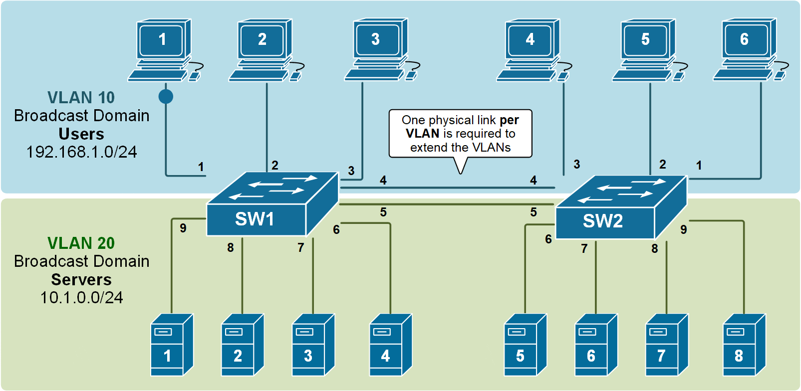
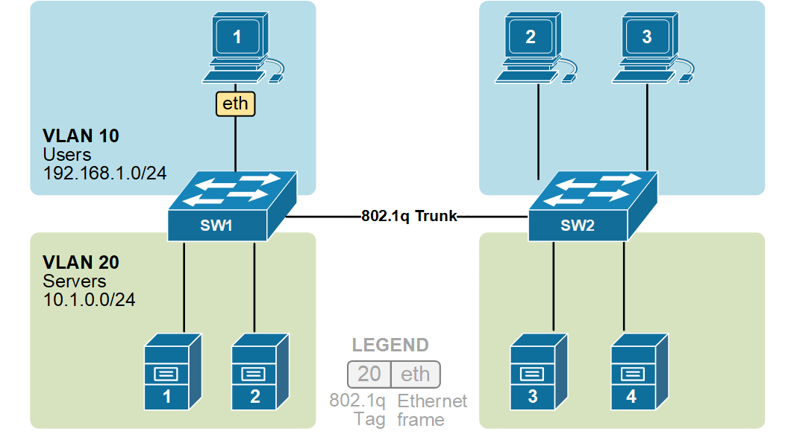

# লেসন ০৬ · Trunk Link ও Inter-VLAN Routing

> **নেভিগেশন:** [⬅ লেসন ০৫](05-vlan.md) · [🏠 হোম](../README.md) · [পরের লেসন ০৭ ➡](07-switching.md)

| 🎯 লক্ষ্য | ⏱️ সময় | 📊 লেভেল | 🧰 ল্যাব ফাইল |
| :--- | :--- | :--- | :--- |
| Trunk Link দিয়ে দুই সুইচে VLAN বহন + Router-on-a-Stick Inter-VLAN Routing | ~৬০ মিনিট | 🟡 Intermediate | [lesson-06-trunk-inter-vlan.pkt](../pkt-files/labs/lesson-06-trunk-inter-vlan.pkt) |

**Tags:** `#trunk` `#802.1q` `#inter-vlan` `#router-on-a-stick` `#subinterface` `#encapsulation-dot1q`

---

## 🎯 এই লেসনে যা শিখবে

1. **Trunk Link কী** — একটি কেবলে একাধিক VLAN-এর ট্রাফিক
2. **Access Port vs Trunk Port**-এর পার্থক্য
3. দুই সুইচের মধ্যে **Trunk Configure** (802.1Q)
4. **Inter-VLAN Routing (Router-on-a-Stick)** — Subinterface + `encapsulation dot1Q`
5. ভিন্ন VLAN-এর PC-দের মধ্যে **Ping সফল** করা

---

# 📖 Part 1 — Trunk Link কী?

**Trunk Link** হলো এমন একটি লিংক, যা একটি মাত্র ফিজিক্যাল কেবলে **একাধিক VLAN-এর ট্রাফিক** একই সঙ্গে বহন করে। প্রতিটি ফ্রেমে **VLAN Tag (802.1Q)** যুক্ত থাকে, তাই গ্রহণকারী সুইচ বুঝতে পারে ফ্রেমটি কোন VLAN-এর।

### 🔹 Trunk Link Topology
```text
        SW1                          SW2
   ┌────┴────┐                  ┌────┴────┐
 VLAN 10  VLAN 20            VLAN 10  VLAN 20
   PC0      PC1                PC2      PC3
     \      /                    \      /
      \    /                      \    /
    Fa0/1  Fa0/2                Fa0/1  Fa0/2

   SW1 G0/1 ════════ Trunk (802.1Q) ════════ G0/1 SW2
        একই কেবলে VLAN 10 + VLAN 20 — দুটোরই ট্রাফিক ✅
```

### 🔹 Trunk ছাড়া হলে কী হতো?

Trunk না থাকলে প্রতি VLAN-এর জন্য **আলাদা আলাদা ফিজিক্যাল লিংক** লাগত — VLAN বাড়লে কেবল ও সুইচ পোর্টও বাড়তে থাকত। নিচের অ্যানিমেশনে সেটাই দেখানো:



✅ তাই একটাই **Trunk Link** সব VLAN-এর ট্রাফিক বহন করে — কেবলও কম লাগে, ব্যবস্থাপনাও সহজ।

## ১. Access Port বনাম Trunk Port

| বিষয় | Access Port | Trunk Port |
| :--- | :--- | :--- |
| **সংযুক্ত ডিভাইস** | PC, Printer, Server (End Device) | Switch ↔ Switch, Switch ↔ Router |
| **VLAN সংখ্যা** | শুধু **একটি** VLAN | **একাধিক** VLAN একসাথে |
| **VLAN Tag** | থাকে না (untagged) | 802.1Q Tag থাকে |
| **কমান্ড** | `switchport mode access` | `switchport mode trunk` |

### 🔹 802.1Q VLAN Tagging — ফ্রেমে ট্যাগ কীভাবে বসে?

Trunk-এ প্রতিটি ফ্রেমে একটা ছোট **VLAN Tag (802.1Q)** যুক্ত হয় — ট্যাগে থাকে VLAN ID। তাই গ্রহণকারী সুইচ সহজেই বুঝতে পারে ফ্রেমটি কোন VLAN-এর:



---

# 🧩 Part 2 — Trunk Link Practical Lab

## Step 1: ডিভাইস ও কানেকশন

**ডিভাইস:** ২ × Switch (2960) · ৪ × PC

| From | Port | To | Port | Cable |
| :--- | :--- | :--- | :--- | :--- |
| PC0 | Fa0 | SW1 | Fa0/1 | Straight-Through |
| PC1 | Fa0 | SW1 | Fa0/2 | Straight-Through |
| PC2 | Fa0 | SW2 | Fa0/1 | Straight-Through |
| PC3 | Fa0 | SW2 | Fa0/2 | Straight-Through |
| **SW1** | **G0/1** | **SW2** | **G0/1** | **Cross-Over (সুইচ↔সুইচ)** |

> 💡 সুইচ ↔ সুইচ সংযোগে স্ট্যান্ডার্ড কেবল **Copper Cross-Over** (Auto-MDIX থাকলে Straight-Through-ও চলে)।

## Step 2: উভয় সুইচে VLAN তৈরি

**SW1:**
```cisco
enable
configure terminal
hostname SW1
vlan 10
 name CSE
 exit
vlan 20
 name EEE
 exit
```

**SW2:** (একই ভাবে)
```cisco
enable
configure terminal
hostname SW2
vlan 10
 name CSE
 exit
vlan 20
 name EEE
 exit
```

> 📌 **নিয়ম:** Trunk-এর দুই পাশের সুইচে **একই VLAN ID ও নাম** থাকতে হবে।

## Step 3: Access Port Configure

**SW1:**
```cisco
interface fastEthernet 0/1
 switchport mode access
 switchport access vlan 10
 exit
interface fastEthernet 0/2
 switchport mode access
 switchport access vlan 20
 exit
```

**SW2:**
```cisco
interface fastEthernet 0/1
 switchport mode access
 switchport access vlan 10
 exit
interface fastEthernet 0/2
 switchport mode access
 switchport access vlan 20
 exit
```

## Step 4: Trunk Link Configure (উভয় সুইচে)

**SW1 CLI:**
```cisco
interface gigabitEthernet 0/1
 switchport mode trunk
 exit
end
copy running-config startup-config
```

**SW2 CLI:** (একই কমান্ড)
```cisco
interface gigabitEthernet 0/1
 switchport mode trunk
 exit
end
copy running-config startup-config
```

**Trunk যাচাই:**
```cisco
show interfaces trunk
```
```text
Port        Mode         Encapsulation  Status        Native vlan
Gig0/1      on           802.1q         trunking      1

Port        Vlans allowed on trunk
Gig0/1      1-1005
```

## Step 5: PC IP Address

| PC | VLAN | IP | Mask | Gateway |
| :--- | :---: | :--- | :--- | :--- |
| PC0 | 10 | `192.168.10.1` | `255.255.255.0` | `192.168.10.254` |
| PC1 | 20 | `192.168.20.1` | `255.255.255.0` | `192.168.20.254` |
| PC2 | 10 | `192.168.10.2` | `255.255.255.0` | `192.168.10.254` |
| PC3 | 20 | `192.168.20.2` | `255.255.255.0` | `192.168.20.254` |

## 🧪 Ping Test (Trunk Verification)

```cmd
PC0 (SW1, VLAN10) → ping 192.168.10.2 (PC2, SW2, VLAN10)  ✅ Trunk হয়ে পৌঁছাল!
PC1 (SW1, VLAN20) → ping 192.168.20.2 (PC3, SW2, VLAN20)  ✅
PC0 → ping 192.168.20.1 (VLAN20)                            ❌ ভিন্ন VLAN — স্বাভাবিক Fail
```

> 🎯 **এই Ping-এ প্রমাণ হলো:** একই VLAN-এর ট্রাফিক Trunk লিংক পেরিয়ে অন্য সুইচে যাচ্ছে — অর্থাৎ Trunk সফল! ✅

---

# 🚀 Part 3 — Inter-VLAN Routing কী?

লেসন ০৫-এ দেখেছিলে **ভিন্ন VLAN-এ Ping হয় না**। VLAN Isolation ভাঙতে হলে একটি **Router** লাগে — যেটি ট্রাফিকটাকে এক VLAN থেকে অন্য VLAN-এ **রাউট** করবে। একেই বলে **Inter-VLAN Routing**।

### Router-on-a-Stick কী? 🥢
একটি **মাত্র ফিজিক্যাল Interface**-এর ভেতরে একাধিক **Subinterface** (`G0/0.10`, `G0/0.20`) তৈরি করে প্রতিটি VLAN-এর জন্য আলাদা Gateway হিসেবে কাজ করানো। পুরো নেটওয়ার্কের সাথে রাউটারের সংযোগ "একটি লাঠিতে ঝুলে থাকা বাঁশ" দেখতে মিলে যায় বলে নাম **Router-on-a-Stick**।

### 📌 Inter-VLAN Routing Topology
```text
                     Router R1
                     G0/0 (Trunk)
                        │
                        │ Trunk (802.1Q)
                        │
                     SW1 G0/1
                  ┌─────┴─────┐
               Fa0/1        Fa0/2
                │             │
               PC0           PC1
             VLAN 10        VLAN 20
          192.168.10.1     192.168.20.1
             GW .10.254       GW .20.254
```

| Device | Interface | VLAN | IP |
| :--- | :--- | :---: | :--- |
| R1 | G0/0.10 (subinterface) | 10 | `192.168.10.254` |
| R1 | G0/0.20 (subinterface) | 20 | `192.168.20.254` |
| PC0 | Fa0 | 10 | `192.168.10.1/24`, GW `192.168.10.254` |
| PC1 | Fa0 | 20 | `192.168.20.1/24`, GW `192.168.20.254` |

---

# ⚙️ Part 4 — Inter-VLAN Routing Configuration

## Step 1: Switch Configuration (VLAN + Access + Trunk)

```cisco
enable
configure terminal
hostname SW1

vlan 10
 name CSE
 exit
vlan 20
 name EEE
 exit

interface fastEthernet 0/1
 switchport mode access
 switchport access vlan 10
 exit

interface fastEthernet 0/2
 switchport mode access
 switchport access vlan 20
 exit

! Router-এর সাথে Trunk
interface gigabitEthernet 0/1
 switchport mode trunk
 exit

end
copy running-config startup-config
```

## Step 2: Router Configuration (Subinterfaces)

```cisco
enable
configure terminal
hostname R1

! Physical Interface চালু করতে হবে
interface gigabitEthernet 0/0
 no shutdown
 exit

! VLAN 10-এর Subinterface
interface gigabitEthernet 0/0.10
 encapsulation dot1Q 10
 ip address 192.168.10.254 255.255.255.0
 exit

! VLAN 20-এর Subinterface
interface gigabitEthernet 0/0.20
 encapsulation dot1Q 20
 ip address 192.168.20.254 255.255.255.0
 exit

end
copy running-config startup-config
```

### 💡 কমান্ডগুলোর অর্থ

| Command | কাজ |
| :--- | :--- |
| `interface g0/0.10` | VLAN 10-এর জন্য লজিক্যাল Subinterface |
| `encapsulation dot1Q 10` | 802.1Q Tag-এ VLAN ID 10 শুনবে/পাঠাবে |
| `ip address 192.168.10.254 ...` | VLAN 10-এর সব PC-এর **Default Gateway** |
| `no shutdown` (G0/0) | ফিজিক্যাল ইন্টারফেস না চালালে Subinterface-ও কাজ করবে না! |

---

# 💻 Part 5 — PC Configuration

| PC | IP | Mask | Default Gateway |
| :--- | :--- | :--- | :--- |
| **PC0** (VLAN 10) | `192.168.10.1` | `255.255.255.0` | `192.168.10.254` |
| **PC1** (VLAN 20) | `192.168.20.1` | `255.255.255.0` | `192.168.20.254` |

> ⚠️ Gateway হবে **নিজের VLAN-এর Subinterface IP** — ভুল গেটওয়ে = Ping Fail।

---

# 🧪 Part 6 — Inter-VLAN Routing Test

### 1️⃣ PC0 → PC1 (ভিন্ন VLAN!)
```cmd
ping 192.168.20.1
```
**Expected:**
```text
Reply from 192.168.20.1: bytes=32 time<1ms TTL=127
```
👉 **সফল!** TTL=127 (128 − 1 Router hop)। এটাই প্রমাণ করে ট্রাফিক **Router হয়ে** অন্য VLAN-এ গেছে।

### 2️⃣ PC1 → PC0 (ফিরতি পথ)
```cmd
ping 192.168.10.1
```
✅ Reply — দ্বিমুখী যোগাযোগ সম্পন্ন!

---

# 🔁 Part 7 — লজিক: Packet কীভাবে VLAN পার হয়?

```text
PC0 (VLAN 10, GW .10.254)
  │ 1. Destination 192.168.20.1 — নিজ Subnet-এর বাইরে → Gateway-তে পাঠাও
  ▼
SW1 Fa0/1 → Trunk G0/1 (VLAN 10 Tag সহ)
  ▼
R1 G0/0.10 গ্রহণ → Routing Table দেখে → G0/0.20-এ ফরওয়ার্ড (VLAN Tag বদলায়)
  ▼
SW1 G0/1 (Trunk) → Fa0/2 (Access, VLAN 20)
  ▼
PC1 (192.168.20.1) ✅
```

---

# 🔍 Part 8 — Verification ও Troubleshooting

### 📋 দরকারি কমান্ড
```cisco
show interfaces trunk              ← Trunk স্ট্যাটাস
show vlan brief                    ← VLAN/Port ম্যাপ
show ip interface brief            ← Subinterface up/up
show ip route                      ← কানেক্টেড রুট (C 192.168.10.0/24 …)
```

### ❌ Ping কাজ না করলে কী পরীক্ষা করবে?

1. **Trunk আছে?** — উভয় পাশে `switchport mode trunk`, `show interfaces trunk`
2. **encapsulation ঠিক?** — `encapsulation dot1Q 10`-এর VLAN ID ও Subinterface নম্বর মিলতে হবে (`.10` ↔ `dot1Q 10`)
3. **ফিজিক্যাল Interface UP?** — G0/0-তে `no shutdown` দিয়েছ তো?
4. **PC Gateway মিলছে?** — PC0-এর GW `192.168.10.254`, PC1-এর GW `192.168.20.254`
5. **VLAN Assign ঠিক?** — `show vlan brief`

---

# 🧠 Cheat-Sheet

| কাজ | কমান্ড |
| :--- | :--- |
| Trunk Port | `switchport mode trunk` |
| Trunk দেখা | `show interfaces trunk` |
| Subinterface | `interface g0/0.[VLAN_ID]` |
| 802.1Q Encapsulation | `encapsulation dot1Q [VLAN_ID]` |
| VLAN-এর Gateway | `ip address [GW_IP] [MASK]` (subinterface-এ) |

---

# ✅ Final Checklist

| Task | Expected Result |
| :--- | :--- |
| SW1–SW2 বা SW1–R1 Trunk | `show interfaces trunk`-এ দৃশ্যমান ✅ |
| VLAN 10 + 20 তৈরি | ✅ |
| R1: G0/0.10 + G0/0.20 (encapsulation + IP) | ✅ |
| PC0↔PC1 Inter-VLAN Ping | **Reply (TTL=127)** ✅ |

---

# 🔮 পরের ধাপ

VLAN ও Routing এখন পরিচিত। এবার সুইচের তিনটি শক্তিশালী প্রযুক্তি শিখব — **STP (লুপ প্রতিরোধ), Port Security (নিরাপত্তা), EtherChannel (ব্যান্ডউইথ বৃদ্ধি)** → [লেসন ০৭ · Switching Technologies](07-switching.md)

---

> **নেভিগেশন:** [⬅ লেসন ০৫](05-vlan.md) · [🏠 হোম](../README.md) · [পরের লেসন ০৭ ➡](07-switching.md)

**এই লেসনের Tags:** `#trunk` `#802.1q` `#router-on-a-stick` `#subinterface` `#inter-vlan-routing`
