# লেসন ০৯ · বাস্তব নেটওয়ার্ক হার্ডওয়্যার পরিচিতি (Real Hardware Guide)

> **নেভিগেশন:** [⬅ লেসন ০৮](08-final-project.md) · [🏠 হোম](../README.md) · [পরের লেসন ১০ ➡](10-practice-lab.md)

| 🎯 লক্ষ্য | ⏱️ সময় | 📊 লেভেল | 🧰 pkt ফাইল |
| :--- | :--- | :--- | :--- |
| Packet Tracer-এর প্রতিটি ডিভাইস/কেবল বাস্তবে কেমন দেখায় — আসল ছবি দিয়ে পরিচয় | ~২৫ মিনিট | 🟢 সবার জন্য | নেই (শুধু দেখার লেসন) |

**Tags:** `#hardware` `#real-device` `#cable` `#rj45` `#pairs` `#hub` `#sfp` `#rack` `#console-cable`

---

## 🎯 এই লেসনে যা শিখবে

1. Packet Tracer-এর **Router, Switch বাস্তবে কেমন** — কোন পোর্টগুলো কোথায়
2. **Hub চেনা** — পুরনো যুগের ডিভাইস, বাস্তবে কেমন দেখায় (Switch থেকে পার্থক্যসহ)
3. **কেবলের আসল রূপ** — Straight-Through, Cross-Over, Console (Rollover), Fiber, Coaxial
4. **কেবল বাইরে এক দেখালেও পেয়ার আলাদা** — RJ-45-এর ভেতরের রঙের ক্রম চোখে দেখা
5. **T568A vs T568B** রঙের ক্রম — Straight/Cross/Console কীভাবে চেনবে
6. **SFP, Fiber** কানেক্টর ও মডিউল
7. **Crimping Tool** দিয়ে কেবল তৈরির সরঞ্জাম
8. **Rack ও Patch Panel** ও **PT Device ↔ Real Device** ম্যাপিং টেবিল

> 📌 এই লেসনে কোনো কনফিগারেশন নেই — শুধু **চোখে দেখা ও মনে রাখা**। ল্যাব পরীক্ষা/ইন্টারন্টে এই সব বাস্তব ডিভাইস দেখলে যেন অচেনা না লাগে!

---

# 📡 Part 1 — বাস্তব Router (Real Router)

Packet Tracer-এ তুমি যে **1941 Router** ব্যবহার করো, বাস্তবে সেটা ঠিক এরকম:

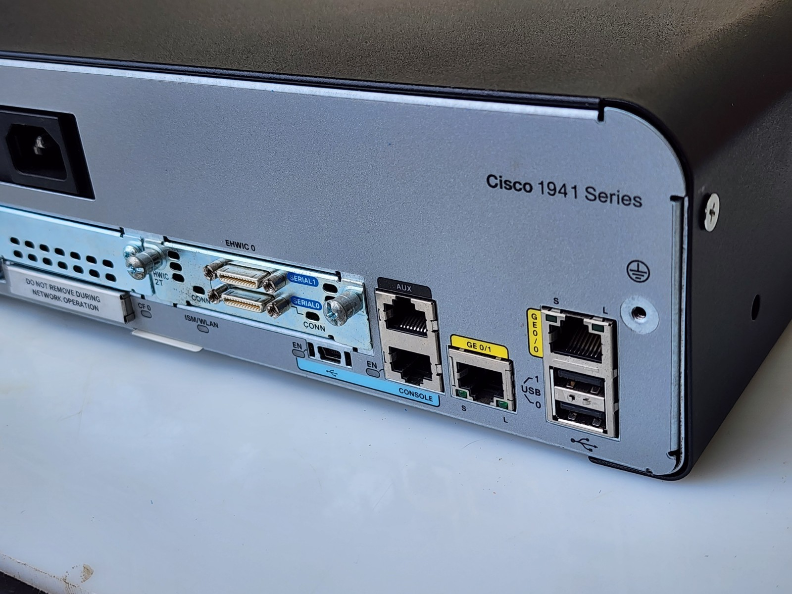
*▲ Cisco 1941 Router — Back Panel (উপরে: পুরো রাউটার, নিচে: পোর্টগুলোর কাছাকাছি দৃশ্য)*

### 🔍 বাস্তব Router-এ যা যা থাকে

| পোর্ট/অংশ | কেমন দেখায় | কাজ |
| :--- | :--- | :--- |
| **GigabitEthernet 0/0, 0/1** | হলুদ রঙের RJ-45 পোর্ট | PT-তে যেমন `G0/0`, `G0/1` — LAN/WAN সংযোগ |
| **Console Port** | সবচেয়ে বাঁদিকে ছোট RJ-45 পোর্ট, "CONSOLE" লেখা | প্রথমবার কনফিগ করতে **Console কেবল** দিয়ে ল্যাপটপ জোড়া |
| **AUX Port** | Console-এর পাশে | পুরনো মডেম/রিমোট অ্যাক্সেস (আজকাল কম ব্যবহার) |
| **USB Port** | আয়তকার ছোট পোর্ট | ফ্ল্যাশ/কনফিগ কপি |
| **WIC / EHWIC Slots** | ঢোকানো কার্ডের স্লট | Serial বা অতিরিক্ত ইন্টারফেস কার্ড লাগানো যায় |
| **Power Switch + Socket** | পিছনে পাওয়ার | চালু/বন্ধ |

> 💡 **মনে রাখো:** PT-তে তুমি যে সব `interface g0/0`, `console` দেখো — বাস্তবে সেগুলো এই রাউটারের **শারীরিক পোর্ট**। কনফিগারেশন কমান্ড হুবহু একই চলে!

### বাস্তবে জনপ্রিয় Router মডেল

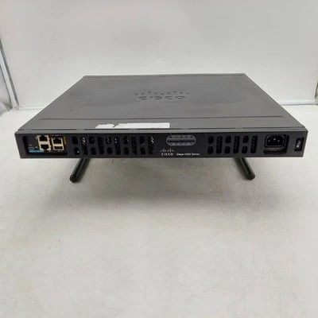
*▲ Cisco ISR 4331 Router — সামনের প্যানেল: পোর্ট, স্লট ও পাওয়ার (PT-তে যে "4331" দেখো, বাস্তবে এরকমই দেখায়)*

| মডেল | কোথায় ব্যবহার | PT-তে সমতুল্য |
| :--- | :--- | :--- |
| **Cisco 1941** | ছোট অফিস/ল্যাব | 1941 (হুবহু এটাই) |
| **Cisco 2911 / 4331 (ISR)** | মাঝারি অফিস | 2911 / 4331 |
| **Home Router (TP-Link/Asus)** | বাসাবাড়ি | Packet Tracer-এ নেই (সমতুল্য: Home Router icon) |

---

# 🔌 Part 2 — বাস্তব Switch (Real Switch)

তোমার ল্যাবের **Cisco 2960 Switch** বাস্তবে এরকম:

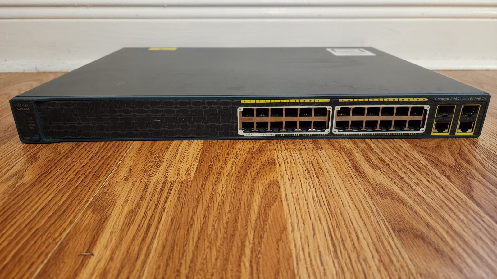
*▲ Cisco Catalyst 2960 Switch — Front Panel (সারি সারি পোর্ট, ডানে Uplink ও প্রতিটি পোর্টে LED)*

### 🔍 বাস্তব Switch-এ যা যা থাকে

| অংশ | কেমন দেখায় | কাজ |
| :--- | :--- | :--- |
| **Fa0/1 – Fa0/24 (বা 48)** | সামনে সারি সারি RJ-45 পোর্ট | PC, Printer, IP Phone লাগানো — PT-তে যেমন `Fa0/1` |
| **GigabitEthernet Uplink (SFP)** | পোর্টের পাশে ছোট গর্তের স্লট | Fiber/SFP মডিউল — রাউটার বা অন্য সুইচে Uplink |
| **Console Port** | পাশে আলাদা | সুইচ কনফিগ করতে |
| **LED Lights** | প্রতিটি পোর্টে ছোট বাতি | 🟢 সবুজ = Link Up, 🟠 কমলা = STP Learning, ⚫ বন্ধ = Link Down |
| **System LED** | সামনে SYST | সুইচ চালু আছে কি না |

> 💡 **ল্যাব টিপ:** তুমি যখন কেবল লাগাও, তখন PT-তে যে Amber→Green বাতি দেখো — বাস্তবেও হুবহু সেই LED-ই সবুজ হয়। লোকাল পরীক্ষায় LED দেখে Link Status বলতে বলতে পারে!

### পুরনো ল্যাবের সুইচ: Cisco Catalyst 2950

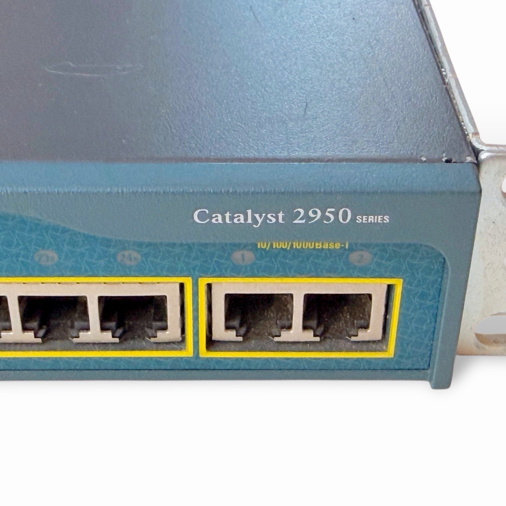
*▲ Cisco Catalyst 2950 (ক্লোজ-আপ) — নীলাভ চেসিস, হলুদ বর্ডারে পোর্ট ও "Catalyst 2950 SERIES" লেখা; PT-তে যে "2950-24 / 2950T" আছে সেটাই*

> 📌 PT-এর সুইচ তালিকায় **IE 2000** (ইন্ডাস্ট্রিয়াল সুইচ), **PT-Switch / PT-Empty / PT-Bridge** (ভার্চুয়াল/খালি) থাকলেও ওগুলোর ছবি/বিস্তারিত লাগবে না — অপ্রয়োজনীয় হলে skip! ল্যাবে আসলে যেগুলো দেখবে **2960 ও 2950** — সে দুটোই উপরে আছে।

### 📡 বাস্তব Hub (Real Hub) — পুরনো যুগের ডিভাইস

PT-তে তুমি **Hub, PT-Repeater, Coaxial Splitter** দেখো — এগুলো আজকাল প্রায় ব্যবহার হয় না, তবে চিনে রাখা দরকার:

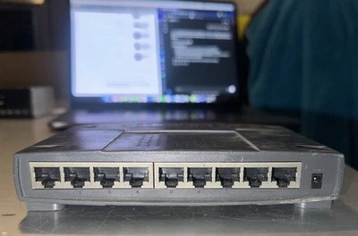
*▲ বাস্তব Ethernet Hub (8-Port) — সামনে সারি সারি পোর্ট; দেখতে প্রায় Switch-এর মতোই!*

| বিষয় | Hub | Switch |
| :--- | :--- | :--- |
| **ট্রাফিক** | সব পোর্টে একসাথে পাঠায় (shared) | শুধু গন্তব্য পোর্টে |
| **Collision Domain** | পুরো Hub-এ **একটাই** | প্রতি পোর্টে আলাদা |
| **গতি** | ডিভাইস বাড়লে ধীর হয়ে যায় | দ্রুত |
| **আজকাল** | প্রায় বিলুপ্ত | সবখানেই |

> 🧠 **মনে রাখবে:** **Hub = পুরনো, Switch = আধুনিক**। দেখতে প্রায় এক দেখালেও Hub-এর সব পোর্ট একই collision domain-এ — তাই আজকাল শুধু চেনার জন্যই মনে রাখতে হয়। PT-তে Hub বসালে ট্রাফিক ধীর হয় — একই কারণে!

---

# 🔌 Part 3 — বাস্তব কেবল (Real Cables)

⚠️ **সবচেয়ে জরুরি কথা:** বাস্তবে প্রায় সব কেবল বাইরে **এক দেখায়** (একই ধরনের জ্যাকেট + স্বচ্ছ RJ-45) — PT-তে রঙ দেখিয়ে যা আলাদা করায়, আসলে সেই আলাদা করা যায় **ভেতরের তারের জোড়া (pair) ও তাদের রঙের ক্রম** দেখে। তাই প্রতিটি কেবলের ছবির সাথে **পেয়ার কেমন** সেটা মনে রাখো।

| PT-এর কেবল | কোথায় ব্যবহার (PT-তে যেমন) | বাস্তবে কেমন (পেয়ার/কানেক্টর) |
| :--- | :--- | :--- |
| **Copper Straight-Through** | PC↔Switch, Switch↔Router, PC↔Hub | দুই প্রান্তে **একই রঙের ক্রম** (T568B—T568B) — সবচেয়ে বেশি ব্যবহৃত |
| **Copper Cross-Over** | Switch↔Switch, Router↔Router, PC↔PC | দুই প্রান্তে **ভিন্ন রঙের ক্রম** (T568A—T568B) — পেয়ারগুলো উল্টানো |
| **Console (Rollover)** | PC ↔ Router/Switch Console Port | হালকা নীল (Light Blue); তার **উল্টো ক্রমে** (1↔8) — এক প্রান্ত RJ-45, অন্য প্রান্ত DB9 (COM পোর্ট) |
| **Fiber (LC)** | Switch Uplink, লম্বা দূরত্ব | হলুদ/কমলা পাতলা কেবল — তার নেই, **আলো** দিয়ে ডেটা |
| **Coaxial (BNC)** | পুরনো নেটওয়ার্ক (10BASE2) | মোটা গোল কেবল, মাঝে একটাই তার + **BNC** কানেক্টর |
| **Serial (DCE/DTE)** | Router↔Router WAN (পুরনো ল্যাব) | মোটা কেবল, বড় ধূসর কানেক্টর |

## ১. Ethernet কেবল + RJ-45 — ভেতরের পেয়ার দেখো

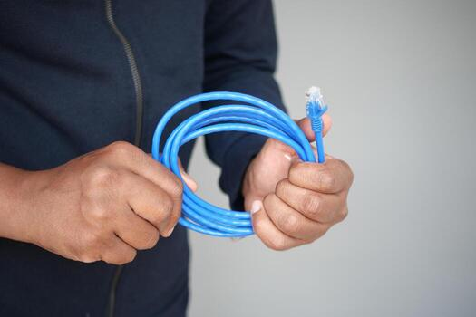
*▲ Cat6 Ethernet কেবল — সবুজ, নীল, হলুদ রঙে থাকে; শেষে স্বচ্ছ **RJ-45** কানেক্টর (8P8C)*

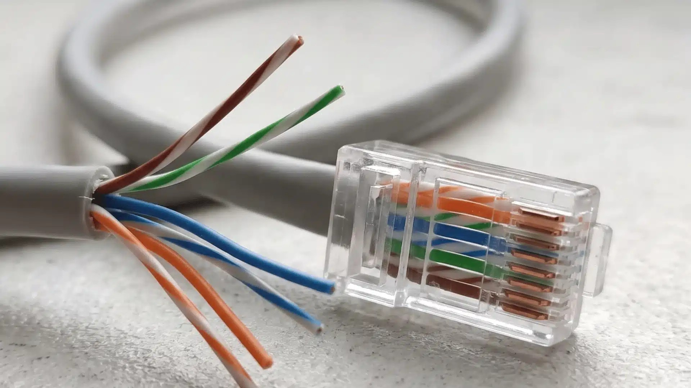
*▲ স্বচ্ছ RJ-45-এর ভেতরে ৮টি তার কেমন বসে — ৪টা পেয়ার: 🟧 কমলা, 🟩 সবুজ, 🟦 নীল, 🟫 বাদামি (প্রতি পেয়ারে একটা সাদা-ডোরা + একটা রঙিন তার)। **এই রঙের ক্রমই কেবলের পরিচয়!***

## ২. Straight-Through vs Cross-Over — বাইরে এক, পেয়ার আলাদা!

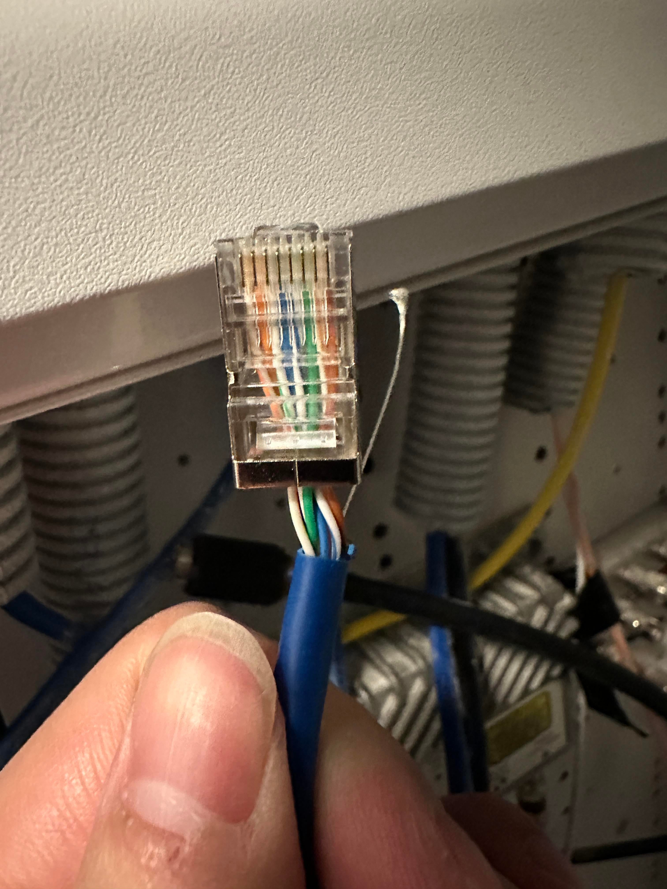
*▲ বাস্তব ফিল্ডে crimp করা RJ-45 — স্বচ্ছ কানেক্টরের ভেতরে রঙের ক্রম বসে যায়; ঠিক এই ক্রম দেখেই বোঝা যায় কোন কেবল*

> 🔍 **কীভাবে চেনবে** — কেবলের দুই প্রান্তের কানেক্টর ধরে রঙের ক্রম **মিলিয়ে দেখো**:
> * দুই প্রান্তে **একই ক্রম** → **Straight-Through** ✅
> * দুই প্রান্তে **ভিন্ন ক্রম** → **Cross-Over**
> * তার **উল্টো ক্রমে** (1↔8) → **Console (Rollover)**
>
> নিচের T568A/B টেবিলে দুই ক্রমের রঙ দেওয়া আছে — ছবির সাথে মিলিয়ে দেখো।

## ৩. Console (Rollover) কেবল

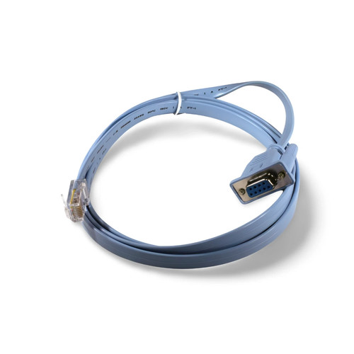
*▲ Cisco Console Cable — এক প্রান্তে RJ-45 (রাউটারের CONSOLE), অন্য প্রান্তে DB9 (কম্পিউটারের COM/Serial) — বাংলায় "রোলোভার কেবল"*

## ৪. 🎨 T568A vs T568B রঙের ক্রম (মনে রাখলে কেবল বানাতে পারবে)

| পিন | T568B (বেশি ব্যবহৃত) | T568A |
| :---: | :--- | :--- |
| 1 | 🟧 সাদা-কমলা | 🟩 সবুজ-সাদা |
| 2 | 🟧 কমলা | 🟩 সবুজ |
| 3 | 🟩 সবুজ-সাদা | 🟧 কমলা-সাদা |
| 4 | 🟦 নীল | 🟦 নীল |
| 5 | 🟦 সাদা-নীল | 🟦 সাদা-নীল |
| 6 | 🟩 সবুজ | 🟧 কমলা |
| 7 | 🟫 সাদা-বাদামি | 🟫 সাদা-বাদামি |
| 8 | 🟫 বাদামি | 🟫 বাদামি |

> **সহজ নিয়ম:**
> * **Straight-Through** = দুই প্রান্তে একই স্ট্যান্ডার্ড (B—B বা A—A) → ভিন্ন ধরনের ডিভাইস
> * **Cross-Over** = এক প্রান্ত A, অন্য প্রান্ত B → একই ধরনের ডিভাইস
> * **Console** = উল্টো ক্রম (1↔8, 2↔7, 3↔6, 4↔5)

## ৫. Fiber ও SFP মডিউল

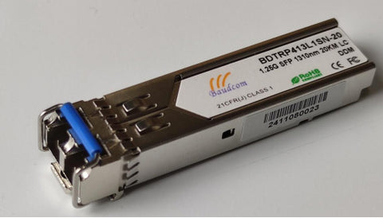
*▲ SFP Transceiver Module — সুইচের Uplink স্লটে ঢোকে, সামনে **LC** কানেক্টর দিয়ে Fiber কেবল লাগে*

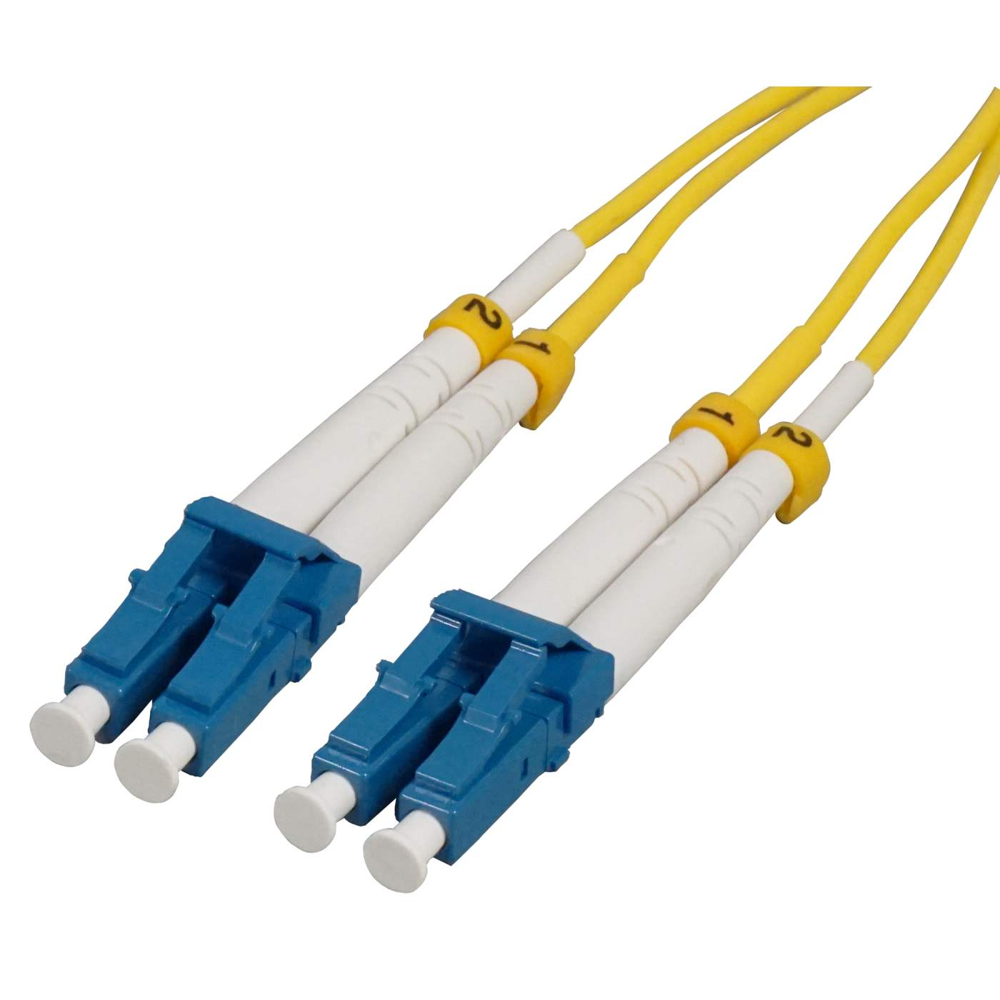
*▲ Fiber Patch Cable — হলুদ স্লিভ, শেষে **LC** কানেক্টর (দুটো পাশাপাশি = Duplex — একটায় পাঠানো, অন্যটায় আসা)*

| অংশ | কাজ |
| :--- | :--- |
| **SFP Module** | সুইচের ছোট স্লটে ঢোকানো মডিউল — এতে Fiber বা তামার Uplink লাগে |
| **Fiber Cable (LC Connector)** | আলো দিয়ে ডেটা — লম্বা দূরত্ব (কয়েক কিমি) ও উচ্চ গতি |
| **কেন Fiber?** | বিল্ডিং-বিল্ডিং সংযোগ, ডেটা সেন্টার Uplink — বিদ্যুৎচৌম্বকীয় হস্তক্ষেপ নেই |

## ৬. Coaxial ও Serial — পুরনো কেবল, তবে চিনে রাখো

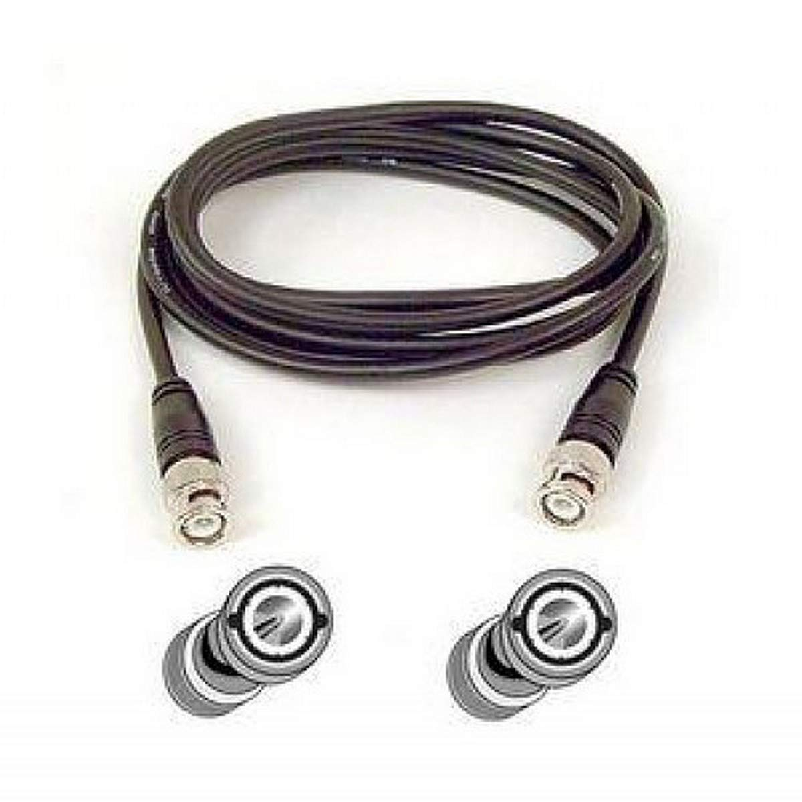
*▲ Coaxial কেবল (RG-58) + **BNC** কানেক্টর — মাঝে একটাই তার, চারপাশে শিল্ড; পুরনো "Thin Ethernet" নেটওয়ার্কে ব্যবহৃত হতো*

> 📌 আজকাল অফিসে Coaxial/Serial প্রায় দেখা যায় না — তবে PT-এর কেবল তালিকায় (Coaxial, Serial DCE/DTE) আছে, তাই ছবি দেখে চিনে রাখো। দরকার না হলে বিস্তারিত skip করা যায়।

---

# 🛠️ Part 4 — কেবল তৈরির সরঞ্জাম

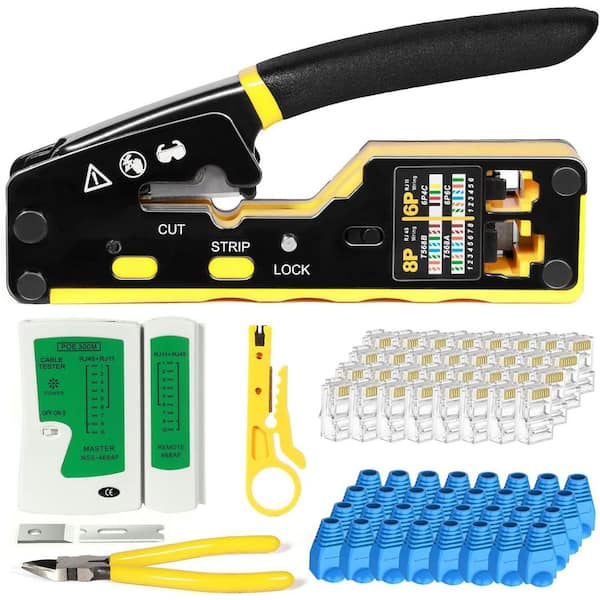
*▲ RJ-45 Crimping Kit — Crimping Tool, Wire Stripper, Cable Tester একসাথে*

| সরঞ্জাম | কাজ |
| :--- | :--- |
| **Crimping Tool** | RJ-45 কানেক্টরে তার চেপে (crimp) জোড়া লাগানো |
| **Wire Stripper** | কেবলের আবরণ খোলা |
| **Cable Tester** | কেবল ঠিক আছে কি না — ৮টি তার পরপর জ্বলে কি না দেখা |

> 🔧 ল্যাব পরীক্ষায় বলতে পারে: *"কেবল কাটার পর কীভাবে যাচাই করবে?"* — উত্তর: **Cable Tester** দিয়ে — দুই প্রান্তে ১-৮ পর্যন্ত বাতি সিরিয়ালে জ্বলতে হবে।

---

# 🗄️ Part 5 — আসল Network Rack ও Patch Panel

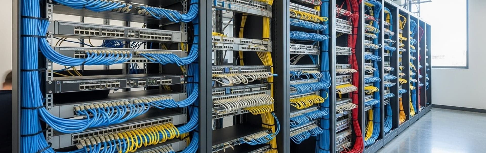
*▲ বাস্তব Data Rack — Patch Panel, Switch ও সুবিন্যস্ত কেবলিং (সবগুলো লেবেল দেওয়া)*

| অংশ | কাজ |
| :--- | :--- |
| **Rack (19" Cabinet)** | Router, Switch, Server রাখার ধাতুর ফ্রেম |
| **Patch Panel** | দেয়াল/ডেস্কের সব কেবল এক জায়গায় এনে সুইচে লাগানো — ব্যবস্থাপনা সহজ |
| **Patch Cord** | Patch Panel ↔ Switch সংযোগের ছোট রঙিন কেবল |
| **Cable Management** | তারগুলো সোজা রাখার পাতা — আলগা তার থাকলে সমস্যা হয় |
| **Labels** | প্রতিটি কেবলে নম্বর/নাম — সমস্যা হলে দ্রুত খুঁজে পাওয়া যায় |

> 🏢 তোমার বিশ্ববিদ্যালয়ের Lab/Office-এ গেলে দেখবে ঠিক এই Rack — ভেতরে তোমার ল্যাবের **2960 সুইচ** সারি সারি বসানো!

---

# 🗺️ Part 6 — PT Device ↔ Real Device ম্যাপিং

| Packet Tracer-এ যা দেখো | বাস্তবে কী | তোমার ল্যাবের ফাইল |
| :--- | :--- | :--- |
| **Router 1941** | Cisco 1941 ISR Router | [lesson-01-router-cli-basics.pkt](../pkt-files/labs/lesson-01-router-cli-basics.pkt) |
| **Router 4331 / 2911** | Cisco ISR (মাঝারি অফিসের রাউটার) | — |
| **Switch 2960** | Cisco Catalyst 2960 (24/48-port) | [lesson-02-static-routing.pkt](../pkt-files/labs/lesson-02-static-routing.pkt) |
| **Switch 2950-24 / 2950T** | Cisco Catalyst 2950 (পুরনো ল্যাব সুইচ) | — |
| **Hub-PT / PT-Repeater** | বাস্তব Ethernet Hub (আজকাল ব্যবহার হয় না) | — |
| **PC-PT** | আসল ডেস্কটপ/ল্যাপটপ | সব ল্যাবে |
| **Server-PT** | Rack-mount Server (Dell/HP) | লেসন ০৪ ও ০৮ |
| **Printer-PT** | Network Printer | [office-shared-printer-network.pkt](../pkt-files/practice/office-shared-printer-network.pkt) |
| **Copper Straight-Through** | সাদা/নীল/সবুজ Cat5e/Cat6 কেবল | সব ল্যাবে |
| **Copper Cross-Over** | কমলা-সবুজ ভিন্ন ক্রমের কেবল | লেসন ০২ (Router↔Router) |
| **Console Cable** | Light Blue Rollover কেবল | প্রথমবার ডিভাইস কনফিগে |
| **SFP + Fiber** | সুইচের Uplink | বড় নেটওয়ার্কে |

---

# ❓ দ্রুত পরীক্ষা (মনে রাখা যাচাই)

1. Router-এর **Console Port** কেন ব্যবহার হয়?
2. **Straight-Through vs Cross-Over** — কোনটা কখন?
3. Switch-এর **কমলা LED** মানে কী?
4. **SFP Module** কোথায় বসে এবং কেন?
5. **Patch Panel** ছাড়া নেটওয়ার্কে কী সমস্যা হয়?
6. Hub ও Switch দেখতে প্রায় এক — **আসল পার্থক্য** কী?

💡 উত্তর দেখো

1. Router প্রথমবার কনফিগ করতে (IP না থাকায় Telnet/SSH কাজ করে না) — Console কেবল দিয়ে সরাসরি ল্যাপটপ থেকে CLI খোলা হয়।
2. Straight-Through = ভিন্ন ধরনের ডিভাইস (PC↔Switch, Switch↔Router); Cross-Over = একই ধরনের (Switch↔Switch, PC↔PC, Router↔Router)।
3. Amber (কমলা) = পোর্ট STP Listening/Learning অবস্থায় আছে — কিছুক্ষণ পর সবুজ হবে।
4. Switch-এর **Uplink SFP স্লট**ে বসে; Fiber লাগিয়ে লম্বা দূরত্ব/উচ্চ গতির সংযোগ করা হয়।
5. সব কেবল এলোমেলো গুঁড়িয়ে যায়, সমস্যা খুঁজে পাওয়া কঠিন হয়, পোর্ট পরিবর্তনে সময় বেশি লাগে।
6. Hub-এর সব পোর্ট **একই collision domain**-এ (সবাই একসাথে কথা বলে, তাই ধীর); Switch-এ প্রতি পোর্ট আলাদা — ট্রাফিক শুধু গন্তব্য পোর্টে যায়। তাই আজকাল সবখানে Switch, Hub প্রায় বিলুপ্ত।

---

# ✅ Final Checklist

| বিষয় | মনে আছে? |
| :--- | :--- |
| Router-এ Console, GE, WIC পোর্ট চেনা | ☐ |
| Switch-এ ২৪/৪৮ পোর্ট + SFP Uplink + LED চেনা | ☐ |
| Straight-Through / Cross-Over / Console কেবল আলাদা করা | ☐ |
| কানেক্টরের **রঙের ক্রম দেখে** Straight/Cross/Console চেনা | ☐ |
| T568A/B রঙের ক্রম (কমপক্ষে T568B) মনে রাখা | ☐ |
| Hub চেনা ও Switch থেকে পার্থক্য বলা | ☐ |
| SFP, Fiber, Crimping Tool, Patch Panel চেনা | ☐ |

---

# 🔮 পরের ধাপ

এবার তুমি বাস্তব সরঞ্জামও চেনো! এবার সময় **নিজে হাতে-কলমে অনুশীলনের** — সমাধানসহ Practice Lab → [লেসন ১০ · Practice Lab (সমাধানসহ)](10-practice-lab.md)

---

> **নেভিগেশন:** [⬅ লেসন ০৮](08-final-project.md) · [🏠 হোম](../README.md) · [পরের লেসন ১০ ➡](10-practice-lab.md)

**এই লেসনের Tags:** `#hardware` `#router-ports` `#switch-ports` `#hub` `#t568b` `#pairs` `#console` `#sfp` `#patch-panel`
