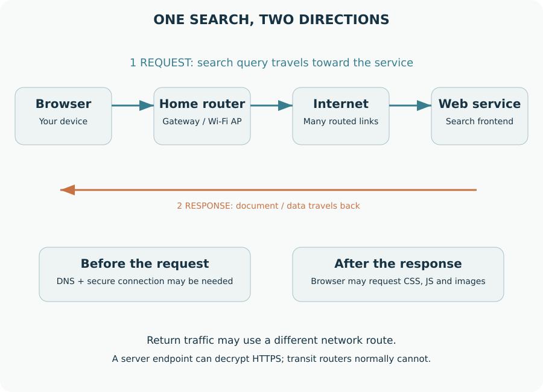
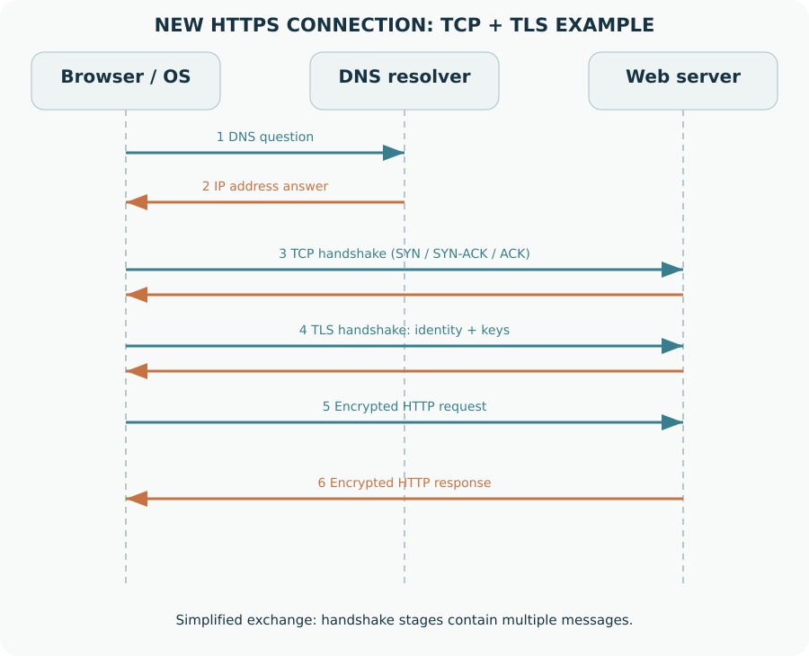
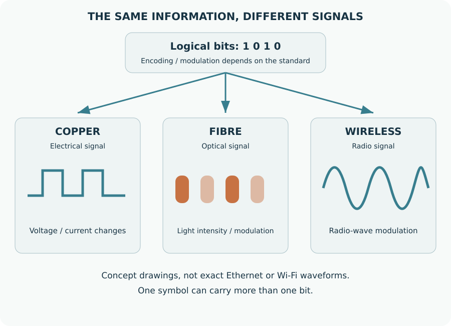
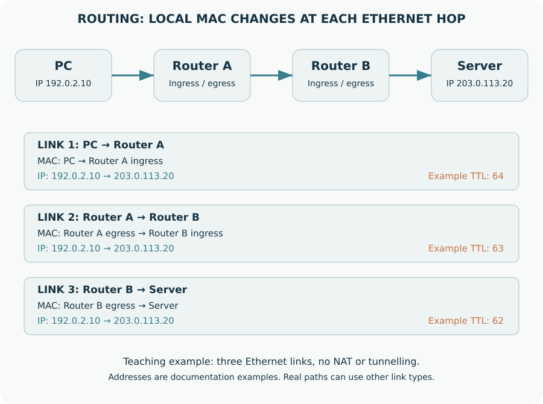
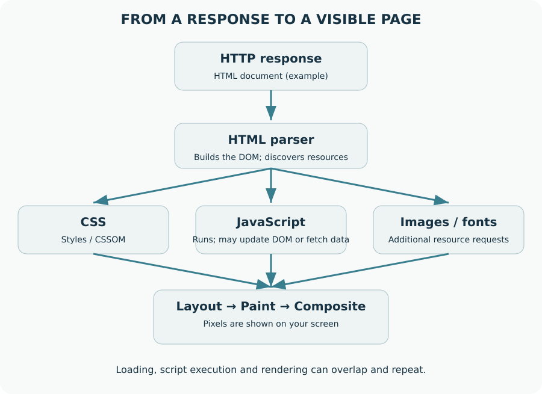
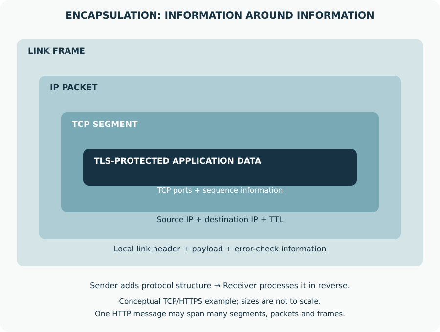

# OSI: From Search to Screen

## 7 Layers. One Journey.

বাংলা ব্যবহারিক গাইড

**MaksDev Studio**

**Md. Makshedul Islam**

Student, EXIM Bank Agricultural University Bangladesh.

## বিষয়সূচি

1. একটি সার্চের পেছনে কী ঘটে?
2. সাতটি Layer, একটি যোগাযোগ
3. Enter চাপার আগেই সিদ্ধান্ত শুরু
4. ডোমেইনের IP খুঁজে পাওয়া
5. Bit থেকে signal
6. Copper, fibre ও wireless
7. আলো জ্বললেই কি ইন্টারনেট চলে?
8. Local link-এ frame চলাচল
9. IP জানা আছে, MAC কোথা থেকে আসবে?
10. IP address ও routing
11. সঠিক application-এ ডেটা পৌঁছানো
12. Reliability, flow control ও delay
13. কথোপকথনের ধারাবাহিকতা
14. Representation, compression ও encryption
15. HTTP দিয়ে request ও response
16. Search engine বনাম অন্য ওয়েবসাইট
17. একই data, ভিন্ন স্তরের মোড়ক
18. Model-এর সঙ্গে implementation মিলিয়ে দেখা
19. সমস্যা হলে নিচ থেকে শুরু করুন
20. নিজের request নিজেই দেখুন
21. বন্ধ port চালু করে link পরীক্ষা
22. একটি সমস্যা, একাধিক প্রমাণ
23. প্রশ্ন, উত্তর ও ছোট challenge
24. Browser থেকে server, আবার browser

এটি শিক্ষামূলক স্বতন্ত্র গাইড, কোনো বিশ্ববিদ্যালয়ের আনুষ্ঠানিক প্রকাশনা নয়।

# 01 | শুরু এখান থেকেই
## একটি সার্চের পেছনে কী ঘটে?

আপনি ব্রাউজারের search box-এ লিখলেন: **“OSI model বাংলা”**। Enter চাপার পর কয়েক মুহূর্তেই ফলাফল দেখা গেল। কিন্তু আপনার লেখা সরাসরি তার বেয়ে সার্ভারে পৌঁছায় না। লেখাটি application data হয়, প্রয়োজনমতো এনক্রিপ্ট হয়, transport ও network তথ্য যুক্ত হয়, এবং শেষ পর্যন্ত তার, আলো বা radio signal হিসেবে চলাচল করে।

উত্তর আসার সময় প্রক্রিয়াটি উল্টো দিকে ঘটে। ব্রাউজার ডেটা গ্রহণ করে, নিরাপত্তা যাচাই ও decoding করে, HTML পড়ে এবং প্রয়োজনীয় CSS, JavaScript, ছবি ও font সংগ্রহ করে পৃষ্ঠা দেখায়। এই কাজগুলো বোঝার একটি মানসিক মানচিত্র হলো **OSI model**।

### বইটি কীভাবে পড়বেন

প্রথমে পুরো যাত্রাটি দেখব। তারপর নিচ থেকে Physical → Data Link → Network → Transport → Session → Presentation → Application স্তর বুঝব। শেষে একই যাত্রা আবার মিলিয়ে দেখব এবং ছোট ল্যাবে পরীক্ষা করব।

### আগে চারটি শব্দ শিখুন

| শব্দ | সহজ অর্থ | উদাহরণ |
|---|---|---|
| Client | যে সেবা চায় | আপনার browser |
| Server | যে সেবা দেয় | ওয়েব সার্ভার বা DNS resolver |
| Protocol | যোগাযোগের নিয়ম | HTTP, TCP, IP |
| Interface | নেটওয়ার্কে যুক্ত হওয়ার সংযোগমুখ | Ethernet বা Wi-Fi adapter |

### একটি সহজ উপমা

আপনি দোকানে একটি পণ্য চাইলেন। আপনার চাহিদা হলো application message; ঠিকানা লেখা হলো addressing; বহন করার ব্যবস্থা হলো transport ও network; রাস্তা ও মাধ্যম হলো link ও physical। উপমাটি ধারণা দেয়, কিন্তু বাস্তব protocol-এর সব নিয়ম বোঝায় না।

> **শেখার লক্ষ্য:** বই শেষে আপনি বলতে পারবেন—কোন ঠিকানা কোথায় লাগে, কোন স্তরে কী দায়িত্ব থাকে এবং কোনো ওয়েবসাইট না খুললে কোথা থেকে পরীক্ষা শুরু করবেন।


---

# 02 | OSI-এর মানচিত্র
## সাতটি Layer, একটি যোগাযোগ

OSI-এর পূর্ণরূপ **Open Systems Interconnection**। এটি যোগাযোগের দায়িত্বগুলো সাতটি স্তরে ভাগ করে বোঝানোর reference model। বাস্তব ইন্টারনেট হুবহু সাতটি আলাদা software box হিসেবে চলে না। একটি protocol বা device একাধিক স্তরের কাজও করতে পারে।

**ডায়াগ্রাম:** Application → Presentation → Session → Transport → Network → Data Link → Physical

| স্তর | মূল প্রশ্ন | পরিচিত ধারণা |
|---|---|---|
| 7 Application | অ্যাপ কী সেবা চাইছে? | HTTP, DNS |
| 6 Presentation | ডেটার representation কী? | encoding, compression, encryption ধারণা |
| 5 Session | কথোপকথনের অবস্থা কীভাবে থাকবে? | session management ধারণা |
| 4 Transport | অ্যাপ্লিকেশনে ডেটা কীভাবে পৌঁছাবে? | TCP, UDP, port |
| 3 Network | কোন নেটওয়ার্ক ও পথে যাবে? | IPv4/IPv6, routing |
| 2 Data Link | এই local link-এ কাকে পাঠাব? | Ethernet/Wi-Fi frame, MAC |
| 1 Physical | কোন signal দিয়ে bit যাবে? | copper, fibre, radio |

### PDU মানে কী?

প্রতিটি স্তরে ডেটার একককে সাধারণভাবে **Protocol Data Unit** বলে। শেখার সুবিধায় application data, TCP segment বা UDP datagram, IP packet, link frame ও bit/symbol বলা হয়। সব protocol-এর ক্ষেত্রে একই নাম চাপিয়ে দেবেন না।

> **মনে রাখুন:** OSI দায়িত্ব বোঝার উপায়; বাস্তব packet-এর ভেতরে সাতটি OSI header থাকতেই হবে—এমন নয়।


---

# 03 | Google সার্চের প্রথম ধাপ
## Enter চাপার আগেই সিদ্ধান্ত শুরু

ধরি আপনার browser-এর default search engine Google। search/address bar-এ সাধারণ বাক্য লিখলে browser সেটিকে search query হিসেবে নেয়। আর `https://example.com` লিখলে সেটি একটি URL হিসেবে খোলার চেষ্টা করে। সব browser-এর configuration একই নয়।

### আমাদের শেখার দৃশ্যপট

- কম্পিউটারটি বাড়ির Wi-Fi router-এর সঙ্গে যুক্ত।
- IP address, default gateway ও DNS configuration আগে থেকেই পাওয়া আছে।
- আমরা বোঝার সুবিধায় একটি নতুন HTTPS connection-এর কথা ধরছি।
- cache, connection reuse, VPN বা proxy থাকলে কিছু ধাপ বদলাতে বা বাদ যেতে পারে।

**ডায়াগ্রাম:** Query / URL → DNS / Cache → Secure connection → HTTP request

### ১. Search URL তৈরি হয়

Browser query-কে উপযুক্তভাবে encode করে search engine-এর URL বা request-এ বসায়। ধারণাগত উদাহরণ:

```text
https://www.google.com/search?q=OSI+model
```

এটি একটি illustrative URL; Google-এর browser-specific request-এ আরও parameter থাকতে পারে। Search query URL-এ গেলে সেটি browser history বা server log-এ থাকতে পারে। HTTPS থাকলেও endpoint নিজেই query পড়তে পারে।

### ২. Server-এর ঠিকানা দরকার

নাম যেমন `www.google.com`, কিন্তু network routing চলে IP address দিয়ে। Browser/OS-এর কাছে ব্যবহারযোগ্য cached address না থাকলে DNS lookup প্রয়োজন হয়।

### ৩. পুরোনো connection কাজে লাগতে পারে

আগে থেকেই Google-এর সঙ্গে connection থাকলে browser সেটি reuse করতে পারে। প্রতিটি সার্চে নতুন DNS lookup, নতুন TCP handshake ও নতুন TLS handshake হয় না।

> **চেকপয়েন্ট:** Google-এ সার্চ মানে Google-এর সেবায় একটি query পাঠানো। এটি আপনার লেখা প্রতিটি ওয়েবসাইটে সরাসরি পাঠানো নয়।


---

## চিত্রে বুঝি: একটি সার্চের দুই দিক

প্রথমে ছবির ওপরের তীরগুলো অনুসরণ করুন। আপনার browser থেকে request local gateway পেরিয়ে service-এর দিকে যায়। নিচের কমলা তীর response-এর দিক দেখায়।



**ছবির যুক্তি ও সীমা:** Router সাধারণত request-এর জন্য নতুন HTTP message তৈরি করে না; packet forward করে। DNS query আলাদা যোগাযোগ, আর নিরাপদ connection নতুন করে প্রয়োজন না-ও হতে পারে। ফেরার packet-এর destination সাধারণত client-এর address; IPv4 NAT থাকলে router mapping ব্যবহার করে।

---

# 04 | DNS: নাম থেকে ঠিকানা
## ডোমেইনের IP খুঁজে পাওয়া

**DNS = Domain Name System**। DNS নামের জন্য বিভিন্ন ধরনের record দেয়। A record IPv4 address, AAAA record IPv6 address, MX mail routing এবং NS authoritative name server বোঝাতে ব্যবহৃত হয়।

### সাধারণ lookup-এর পথ

1. Browser, OS বা configured resolver-এর কাছে cached উত্তর আছে কি না দেখা হয়। নির্দিষ্ট ক্রম implementation অনুযায়ী বদলায়।
2. প্রয়োজন হলে client তার configured recursive resolver-কে query করে।
3. Resolver-এর cache-এ উত্তর না থাকলে সে authoritative তথ্য বের করতে root, TLD ও সংশ্লিষ্ট authoritative server-এর সাহায্য নেয়।
4. উত্তর ও TTL ফেরত আসে; cache policy অনুযায়ী পুনরায় ব্যবহার হতে পারে।

**ডায়াগ্রাম:** Client → Recursive resolver → Authoritative DNS (প্রয়োজনে root ও TLD referral)

### DNS কেবল UDP নয়

প্রচলিত DNS UDP ও TCP port 53 ব্যবহার করতে পারে। DNS-over-HTTPS সাধারণত HTTPS দিয়ে এবং DNS-over-TLS সাধারণত TCP port 853 দিয়ে চলে। Browser-এর Secure DNS setting-এর কারণে browser ও terminal-এর query আলাদা resolver-এ যেতে পারে।

```text
nslookup www.google.com
nslookup -type=AAAA www.google.com
```

এগুলো system configuration ব্যবহার করে নাম resolve করার পরীক্ষা। প্রদর্শিত IP স্থায়ী “একটি Google server” নয়; অঞ্চল, resolver, সময় ও load balancing অনুযায়ী উত্তর বদলাতে পারে।

### কী বুঝবেন?

**NXDOMAIN** মানে DNS নাম না থাকার উত্তর; **timeout** মানে নির্ধারিত সময়ে উত্তর না পাওয়া। এগুলো এক সমস্যা নয়। DNS সফল হলেও server-এর port, TLS বা web application ব্যর্থ হতে পারে।

> **ভুল ধারণা:** DNS ওয়েব পেজ download করে না। এটি নামসংক্রান্ত record খুঁজতে সাহায্য করে।


---

## চিত্রে বুঝি: কার পরে কার পালা?

ওপর থেকে নিচে পড়ুন। DNS নামের ঠিকানা দেয়। এরপর এই উদাহরণে TCP connection ও TLS security তৈরি হয়। সবশেষে HTTP request ও response আদান-প্রদান হয়।



**ছবির যুক্তি ও সীমা:** এটি নতুন TCP-ভিত্তিক HTTPS connection-এর সরলীকৃত sequence, live capture নয়। TCP/TLS পর্যায়ে একাধিক message থাকে। Cached address ও connection reuse হলে ধাপ বাদ যায়; HTTP/3-এ QUIC-এর connection ও security exchange আলাদা। Browser ও DNS resolver-এর ঠিকানার সম্পর্ক আগেই configured আছে বলে ধরা হয়েছে।

---

# 05 | Layer 1 — Physical
## Bit থেকে signal

Physical Layer নির্ধারণ করে একটি নির্দিষ্ট medium দিয়ে তথ্য বহনের signal কীভাবে তৈরি, পাঠানো ও গ্রহণ করা হবে। **Bit** হলো 0 বা 1-এর যৌক্তিক মান; **signal** হলো voltage, light বা radio wave-এর মতো ভৌত প্রকাশ।

**ডায়াগ্রাম:** Bits → Encoding / Modulation → Electrical / Optical / Radio signal

### তিনটি প্রধান মাধ্যম

| মাধ্যম | Signal | কোথায় দেখা যায় |
|---|---|---|
| Copper twisted pair | electrical signal | PC–switch Ethernet link |
| Fibre optic | optical signal | building link, backbone, access network |
| Wireless | radio signal | Wi-Fi client–access point link |

### “১ মানে high, ০ মানে low”—কতটা সত্য?

শুরুতে একটি square wave দিয়ে এই ধারণা বোঝানো হয়। কিন্তু সব network standard সরাসরি প্রতিটি bit-কে একটি high/low level দিয়ে পাঠায় না। Line coding, modulation, multiple voltage level এবং এক symbol-এ একাধিক bit থাকতে পারে।

### Bit rate বনাম symbol rate

**Bit rate** হলো প্রতি সেকেন্ডে কত bit, সাধারণত bit/s। **Symbol rate** হলো প্রতি সেকেন্ডে কত symbol, সাধারণত baud। এক symbol একাধিক bit বহন করতে পারলে দুটি সংখ্যা এক হবে না। বাস্তব payload throughput আবার overhead ও পরিবেশের কারণে link rate-এর চেয়ে কম হয়।

> **Google উদাহরণ:** আপনার query প্রথম Wi-Fi link-এ radio signal হিসেবে যেতে পারে। এরপর অন্য link-এ copper বা fibre ব্যবহার হতে পারে। ইন্টারনেটজুড়ে একই medium থাকে না।


---

## চিত্রে বুঝি: একই তথ্য, ভিন্ন signal

ওপরের bit-গুলো যৌক্তিক তথ্য। নিচের তিনটি বাক্স বোঝায়—সেই তথ্য copper, fibre বা wireless link-এ ভিন্ন ভৌত signal দিয়ে বহন করা যায়।



**ছবির যুক্তি ও সীমা:** Waveform ও light pulse এখানে কেবল ধারণাগত illustration। বাস্তব Ethernet বা Wi-Fi-তে encoding/modulation জটিল; “১ মানে আলো জ্বলা, ০ মানে নিভে যাওয়া” সব standard-এর জন্য সত্য নয়।

---

# 06 | Physical media নির্বাচন
## Copper, fibre ও wireless

কোন medium ভালো—এর একক উত্তর নেই। প্রয়োজনীয় দূরত্ব, link standard, environment, budget, installation ও mobility বিবেচনা করতে হয়।

| বিষয় | Copper | Fibre | Wireless |
|---|---|---|---|
| Signal | electrical | optical | radio |
| দূরত্ব | standard/category অনুযায়ী | optic ও fibre অনুযায়ী | signal ও পরিবেশ অনুযায়ী |
| EMI | প্রভাবিত হতে পারে | optical path EMI-প্রতিরোধী | interference গুরুত্বপূর্ণ |
| Mobility | সীমিত | সীমিত | client mobility সম্ভব |
| ব্যবহার | office LAN | backbone/uplink | Wi-Fi access |

### Copper cable: কয়েকটি বাস্তব সীমা

- **Cat5e:** সাধারণভাবে 1000BASE-T-এর 100 m channel-এ ব্যবহৃত হয়।
- **Cat6:** 1 Gb/s-এর 100 m channel সমর্থন করে; 10GBASE-T-এ প্রায় 55 m পর্যন্ত ব্যবহার শর্ত ও crosstalk-এর ওপর নির্ভরশীল।
- **Cat6A:** যথাযথ installation-এ 10GBASE-T-এর 100 m channel-এর জন্য নির্ধারিত।

100 m channel সাধারণত 90 m permanent link এবং মোট 10 m patch cord ধরে বোঝানো হয়। শুধু cable-এ category লেখা থাকাই সম্পূর্ণ channel performance নিশ্চিত করে না; connector, termination ও installation-ও গুরুত্বপূর্ণ।

### Connector ও network interface

Copper Ethernet-এর পরিচিত plug সাধারণভাবে **RJ45** নামে পরিচিত; সাধারণ Ethernet connector-এর physical form হলো **8P8C**। Network interface বলতে শুধু socket নয়—NIC-এর hardware, PHY ও সংশ্লিষ্ট logic-ও বোঝাতে পারে।

### Fibre ও wireless-এর সীমা

Fibre-এর distance optic-এর wavelength, transceiver, fibre type ও loss budget-এর ওপর নির্ভর করে। Wireless-এর real throughput দেয়াল, interference, channel width, signal strength ও shared airtime-এর ওপর নির্ভরশীল।

> **নিরাপত্তা:** fibre connector-এর ভেতরে তাকাবেন না। কেবল বা optic পরীক্ষা করতে উপযুক্ত সরঞ্জাম ও প্রশিক্ষণ ব্যবহার করুন।


---

# 07 | Link up এবং link down
## আলো জ্বললেই কি ইন্টারনেট চলে?

Ethernet interface ও অপর প্রান্তের device উপযুক্ত physical link স্থাপন করে। অনেক twisted-pair Ethernet link-এ auto-negotiation-এর মাধ্যমে supported speed ও duplex সম্পর্কে সমঝোতা হয়। সব medium বা configuration-এর ধাপ একই নয়।

### Status পরীক্ষা

```text
Switch# show interfaces status
Switch# show interfaces fa0/1
```

অনেক Cisco switch-এ প্রথমটি port summary দেয়। দ্বিতীয়টি বিস্তারিত state ও counter দেখায়। platform, IOS version বা Packet Tracer model অনুযায়ী command support ও output বদলাতে পারে।

| অবস্থা | সম্ভাব্য অর্থ | প্রাথমিক পরীক্ষা |
|---|---|---|
| administratively down | configuration দিয়ে বন্ধ | shutdown আছে কি না |
| notconnect / down | কার্যকর link নেই | cable, power, peer port |
| connected / up | link কাজ করছে | পরের স্তরে VLAN/IP পরীক্ষা |
| err-disabled | সুরক্ষামূলক কারণে port বন্ধ | log ও নির্দিষ্ট cause |

### Speed ও duplex

Half-duplex-এ একই medium-এ পালাক্রমে পাঠানো/গ্রহণ করা হয়; full-duplex-এ দুই দিকে একসঙ্গে সম্ভব। আধুনিক switched Ethernet সাধারণত full-duplex। Wi-Fi-কে একইভাবে Ethernet full-duplex link ধরে নেবেন না।

এক পাশ forced আরেক পাশ auto করলে পুরোনো Ethernet পরিস্থিতিতে duplex mismatch হতে পারে। দুই প্রান্তের compatible setting নিশ্চিত করুন; কারণ না বুঝে speed/duplex force করবেন না।

> **মূল কথা:** link light শুধু নিচের স্তরের connectivity-এর ইঙ্গিত। ভুল VLAN, IP, gateway বা DNS থাকলে link up হলেও ওয়েব পেজ খুলবে না।


---

# 08 | Layer 2 — Data Link
## Local link-এ frame চলাচল

Data Link Layer একটি link-এর ওপর frame আদান-প্রদান, link-level addressing ও error detection-এর মতো দায়িত্ব নিয়ে কাজ করে। Ethernet ও Wi-Fi-এর frame format আলাদা; দুটিই local link-এর যোগাযোগে ভূমিকা রাখে।

### MAC address কী?

Ethernet/Wi-Fi interface-এ ব্যবহৃত MAC address সাধারণত 48-bit। উদাহরণ: `02:11:22:33:44:55`। এটি IP-এর মতো end-to-end routing address নয়। MAC পরিবর্তন, virtual interface বা privacy randomization থাকতে পারে; একে অপরিবর্তনীয় পরিচয় ধরে নেবেন না।

**ডায়াগ্রাম:** PC → Switch → Local gateway বা peer

### Switch কী করে?

সাধারণ Ethernet switch incoming frame-এর **source MAC** দেখে MAC address table শেখে। **Destination MAC** table-এ থাকলে উপযুক্ত port-এ forward করে। একই VLAN-এর unknown unicast সাধারণত অন্য প্রাসঙ্গিক port-এ flood হয়। Broadcast-ও VLAN-এর broadcast domain-এর মধ্যে ছড়ায়।

### VLAN: এক switch, একাধিক logical LAN

VLAN Layer 2 broadcast domain আলাদা করতে সাহায্য করে। দুটি host একই switch-এ লাগানো থাকলেও আলাদা VLAN-এ থাকলে তাদের মধ্যে যোগাযোগের জন্য সাধারণত Layer 3 routing দরকার হয়।

### FCS কী করে?

Ethernet frame-এর Frame Check Sequence corruption detect করতে সাহায্য করে। ক্ষতিগ্রস্ত frame সাধারণত বাদ দেওয়া হয়। Ethernet FCS নিজে end-to-end retransmission guarantee দেয় না; recovery অন্য mechanism বা higher layer-এ হতে পারে। Wi-Fi-তে link-layer acknowledgement/retry-ও থাকে।

> **Google উদাহরণ:** server দূরে হলে PC প্রথম Ethernet frame-টি সাধারণত default gateway-এর local MAC-এ পাঠায়—দূরের Google server-এর MAC-এ নয়।


---

# 09 | ARP, next hop ও বদলে যাওয়া frame
## IP জানা আছে, MAC কোথা থেকে আসবে?

ধরি PC-এর IPv4 হলো `192.168.10.10/24` এবং gateway `192.168.10.1`। PC প্রথমে route ও prefix দেখে গন্তব্য local network-এ, নাকি gateway দিয়ে যেতে হবে তা নির্ধারণ করে।

### একই subnet হলে

গন্তব্য `192.168.10.20` হলে PC ওই local host-এর MAC জানতে ARP ব্যবহার করতে পারে। ব্যবহারযোগ্য cache entry থাকলে নতুন ARP request নাও লাগতে পারে।

### অন্য network হলে

গন্তব্য দূরে হলে PC সাধারণত **gateway-এর IP-এর MAC** খোঁজে। ARP broadcast router পেরিয়ে সমগ্র ইন্টারনেটে Google server খুঁজতে যায় না। IPv6-এ ARP নয়, ICMPv6-ভিত্তিক Neighbor Discovery ব্যবহৃত হয়।

```text
Windows:
arp -a

Linux:
ip neigh show
```

### Router পেরোলে কী বদলায়?

Router incoming link-এর frame খুলে IP packet পরীক্ষা করে। তারপর পরের link-এর জন্য নতুন link-layer encapsulation তৈরি করে। Ethernet hop হলে source ও destination MAC পরের link অনুযায়ী বদলায়। IPv4 TTL বা IPv6 Hop Limit কমে।

| ক্ষেত্র | সাধারণ routed যাত্রায় আচরণ |
|---|---|
| Source/destination MAC | link অনুযায়ী বদলায় |
| Source/destination IP | সাধারণত end-to-end থাকে; NAT হলে বদলাতে পারে |
| TTL / Hop Limit | router-এ কমে |
| Transport port | সাধারণত থাকে; NAT/NAPT-তে বদলাতে পারে |

> **সতর্কতা:** সব Internet link Ethernet নয়। তাই প্রতিটি hop-এ “নতুন Ethernet MAC” লাগবেই—এ কথা সর্বজনীনভাবে ঠিক নয়।


---

## চিত্রে বুঝি: Hop বদলায়, local ঠিকানাও বদলায়

তিনটি link-এর MAC সারি আলাদা করে দেখুন। Router পুরোনো frame থেকে IP packet বের করে পরের Ethernet link-এর জন্য নতুন frame বানায়। IP source ও destination এখানে একই রাখা হয়েছে।



**ছবির যুক্তি ও সীমা:** এখানে NAT ও tunnel নেই এবং সব link Ethernet ধরা হয়েছে। তাই end-to-end IP অপরিবর্তিত; TTL প্রতি router-এ এক কমে। বাস্তবে NAT address/port বদলাতে পারে এবং সব link-এ Ethernet MAC থাকে না। ছবির address-গুলো documentation-এর জন্য সংরক্ষিত উদাহরণ।

---

# 10 | Layer 3 — Network
## IP address ও routing

Network Layer ভিন্ন network-এর মধ্যে packet পৌঁছানোর ব্যবস্থা করে। IP logical addressing দেয়; router routing table অনুযায়ী next hop বা outgoing interface বেছে নেয়। IP নিজে delivery, order বা application success নিশ্চিত করে না।

### IP address ও prefix

`192.168.10.10/24`-এ /24 network prefix-এর দৈর্ঘ্য। সাধারণ উদাহরণে `192.168.10.10/24` ও `192.168.10.20/24` একই subnet-এ। `192.168.20.10/24` অন্য subnet-এ। production network-এ route, VPN ও policy-ও সিদ্ধান্তে প্রভাব ফেলে।

### Default gateway

গন্তব্যের জন্য আরও নির্দিষ্ট route না থাকলে default route কাজে লাগে। Router-এর ক্ষেত্রে destination-এর সঙ্গে মেলা route-গুলোর মধ্যে সাধারণ routing selection-এ longest prefix match গুরুত্বপূর্ণ।

```text
Windows:
ipconfig
route print

Linux:
ip addr show
ip route show
ip route get 8.8.8.8
```

### বাড়ির router-এর একাধিক ভূমিকা

একটি home router একই বাক্সে router, switch, Wi-Fi access point, DHCP server, DNS forwarder ও firewall-এর কাজ করতে পারে। সেজন্য তাকে শুধু এক OSI layer-এর device বলা সব সময় যথেষ্ট নয়।

### NAT-এর সহজ ধারণা

IPv4 home network-এ private source address এবং port অনেক সময় public address/port-এ translate হয়। Router সেই mapping ধরে return traffic সঠিক client-এ পাঠায়। সব connection-এ NAT বাধ্যতামূলক নয়; IPv6 সাধারণত এই উদাহরণের IPv4 NAPT model ব্যবহার করে না।

> **ভুল ধারণা:** NAT মানেই encryption নয়। IP পৌঁছানো গেলেই HTTP server বা TLS certificate সঠিক—এমনও নয়।


---

# 11 | Layer 4 — Transport
## সঠিক application-এ ডেটা পৌঁছানো

এক কম্পিউটারে browser, game ও video call একসঙ্গে চলছে। IP host/interface পর্যন্ত packet পৌঁছাতে সাহায্য করে; transport port এবং protocol information data-কে সঠিক socket/service-এর সঙ্গে যুক্ত করতে সাহায্য করে।

### Port নম্বরের অর্থ

HTTPS server-এর জন্য TCP 443 প্রচলিত; HTTP/3-এর QUIC সাধারণত UDP 443 ব্যবহার করে। Client সাধারণত অস্থায়ী source port নেয়। Port নম্বর protocol বা নিরাপত্তার চূড়ান্ত প্রমাণ নয়।

| বিষয় | TCP | UDP |
|---|---|---|
| Data model | ordered byte stream | datagram |
| Connection setup | transport handshake | TCP-এর মতো handshake নেই |
| Reliability | sequence, ACK, retransmission | নিজস্ব delivery/order guarantee নেই |
| Overhead | তুলনামূলক বেশি | ছোট base header |
| উদাহরণ | HTTP/1.1, HTTP/2 | DNS-এর প্রচলিত query, QUIC |

### TCP handshake

```text
Client  -- SYN -------> Server
Client  <- SYN-ACK ---- Server
Client  -- ACK -------> Server
```

এটি TCP connection স্থাপনের ধারণাগত ধাপ; TLS handshake আলাদা। Server application request প্রক্রিয়াকরণের আগে আরও negotiation বা security প্রয়োজন হতে পারে।

### QUIC কেন গুরুত্বপূর্ণ?

QUIC UDP-এর ওপর reliability, stream ও security mechanism দেয় এবং TLS 1.3 handshake ব্যবহার করে। HTTP/3 QUIC ব্যবহার করে। তাই “UDP হলেই unreliable application”—সিদ্ধান্তটি ভুল; application বা higher protocol প্রয়োজনীয় mechanism যোগ করতে পারে।

> **Google উদাহরণ:** browser HTTP/2 over TCP+TLS অথবা HTTP/3 over QUIC ব্যবহার করতে পারে। সব সার্চ TCP দিয়েই হবে—এমন নয়।


---

# 12 | TCP-এর আরও কিছু কাজ
## Reliability, flow control ও delay

TCP পাঠানো byte-এর ক্রম শনাক্ত করতে sequence number ব্যবহার করে। receiver acknowledgement পাঠায়; loss ধরা পড়লে data retransmit হতে পারে। Application একটি ordered byte stream পায়, তবে TCP message boundary সংরক্ষণ করে না।

### তিনটি দায়িত্ব আলাদা করে বুঝুন

- **Reliability:** হারানো byte পুনরায় পাঠিয়ে stream সম্পূর্ণ করার চেষ্টা। সংযোগ ব্যর্থ হলে application-কে error সামলাতে হয়।
- **Flow control:** receiver কত data গ্রহণ করতে পারবে তার ভিত্তিতে sender-কে সীমিত করা।
- **Congestion control:** network congestion বিবেচনা করে sending behavior নিয়ন্ত্রণ করা।

### Segment, MTU ও MSS

IP packet-এর size link MTU-এর সঙ্গে সম্পর্কিত। TCP MSS হলো একটি TCP segment-এর data payload-এর সীমা নিয়ে negotiation-এর তথ্য। VPN/tunnel overhead usable size কমাতে পারে। MTU সমস্যা হলে কিছু ছোট request চললেও বড় transfer আটকে যেতে পারে।

### একটি সহজ সমস্যা

ধরি link মাঝে মাঝে packet হারাচ্ছে। TCP retransmission করে data ঠিক রাখতে চেষ্টা করবে, কিন্তু delay বাড়তে পারে। তাই video বা interactive app-এ user experience খারাপ হলেও file শেষে সঠিকভাবে নামতে পারে।

```text
Linux socket summary:
ss -tuna

Windows socket summary:
netstat -ano
```

এই output-এ address, port ও connection state দেখুন। অনেক connection থাকা browser-এর ক্ষেত্রে স্বাভাবিক; connection count একাই সমস্যা প্রমাণ করে না।

> **সীমা মনে রাখুন:** TCP data delivery mechanism দেয়, কিন্তু “ব্যবহারকারীর payment একবারই process হবে” ধরনের business guarantee দেয় না। Application-level transaction ও idempotency আলাদা বিষয়।


---

# 13 | Layer 5 — Session
## কথোপকথনের ধারাবাহিকতা

OSI Session Layer communication session তৈরি, পরিচালনা, synchronization ও শেষ করার দায়িত্ব দিয়ে বোঝানো হয়। কিন্তু আধুনিক web stack-এ এটি সাধারণত একটি স্বতন্ত্র দৃশ্যমান “Layer 5 protocol box” হিসেবে পাওয়া যায় না।

### তিন ধরনের session গুলিয়ে ফেলবেন না

| ধারণা | কী ধরে রাখে? |
|---|---|
| TCP connection | transport endpoint-এর connection state |
| TLS session / resumption | secure connection পুনর্গঠনের জন্য security state |
| Web login session | ব্যবহারকারী ও application-এর পরিচয়/অবস্থা |

একটি login session একাধিক TCP বা QUIC connection-এর ওপর চলতে পারে। আবার একই network connection দিয়ে login ছাড়াই বহু request যেতে পারে।

### Cookie ও session token

Server একটি session identifier cookie হিসেবে দিতে পারে। Browser পরবর্তী উপযুক্ত request-এ cookie পাঠালে server user-এর state চিনতে পারে। HTTP cookie ও login ব্যবস্থা মূলত application-level mechanism; শুধু নামের মিল দেখে এগুলোকে আক্ষরিক Layer 5 protocol বলবেন না।

### Google উদাহরণ

Signed-in browser-এর request-এর সঙ্গে উপযুক্ত cookie যেতে পারে। Google সেই application state ব্যবহার করতে পারে। Cookie বন্ধ থাকলেও সাধারণ search request পাঠানো সম্ভব হতে পারে; আচরণ service policy ও configuration-এর ওপর নির্ভর করে।

### নিরাপত্তা

Session token password-এর মতোই সংবেদনশীল হতে পারে। Token বা cookie screenshot, public repository কিংবা diagnostic capture-এ প্রকাশ করবেন না। Logout server-side session বা token-এর অবস্থা বদলাতে পারে; শুধু TCP connection বন্ধ করাই logout নয়।

> **মনে রাখুন:** session একটি গুরুত্বপূর্ণ ধারণা, কিন্তু OSI layer label ও বাস্তব web implementation-এর মধ্যে এক-এক সম্পর্ক নেই।


---

# 14 | Layer 6 — Presentation
## Representation, compression ও encryption

Presentation Layer দিয়ে ব্যাখ্যা করা হয়—দুই প্রান্ত data কোন representation-এ বুঝবে। Character encoding, serialization, compression ও encryption ধারণাগুলো এই আলোচনায় আসে। বাস্তব stack-এ এগুলো বিভিন্ন library ও application protocol-এ বাস্তবায়িত হয়।

### Encoding: বাংলা কীভাবে যাবে?

বাংলা query-কে byte-এ প্রকাশ করতে UTF-8-এর মতো encoding ব্যবহার হয়। URL-এ প্রয়োজন অনুযায়ী percent-encoding বা form encoding লাগতে পারে। Encoding readable representation বদলায়; এটি encryption নয়।

### Compression

Text response-এ gzip বা Brotli-এর মতো compression ব্যবহৃত হতে পারে। এতে transfer size কমে। এটি গোপনীয়তা দেয় না। ইতিমধ্যে compressed ছবি বা video আবার compress করলে একই সুবিধা নাও পাওয়া যেতে পারে।

### TLS: HTTPS-এর নিরাপত্তা

TLS server identity যাচাই, key establishment এবং encrypted/authenticated data transport-এর ব্যবস্থা দেয়। Certificate-এর trust chain, hostname ও validity গুরুত্বপূর্ণ। TCP-ভিত্তিক HTTPS-এ TLS TCP-এর ওপর থাকে; QUIC TLS 1.3 handshake সমন্বিতভাবে ব্যবহার করে।

```text
HTTP/2 example:
HTTP data → TLS protection → TCP → IP → Link

HTTP/3 example:
HTTP data → QUIC (TLS-based security) → UDP → IP → Link
```

### Encryption কী লুকায়, কী লুকায় না?

HTTPS সাধারণত browser ও TLS-terminating endpoint-এর মধ্যে HTTP content সুরক্ষিত করে। Endpoint data পড়তে পারে। Destination IP, traffic timing ও size-এর মতো metadata দৃশ্যমান থাকতে পারে। DNS ও hostname privacy ব্যবহৃত প্রযুক্তি/configuration অনুযায়ী বদলায়।

> **সঠিক mapping:** TLS-কে শেখানোর সময় Layer 6-এর সঙ্গে তুলনা করা যায়, কিন্তু বাস্তব TLS-কে OSI-এর একটি নির্দিষ্ট layer-এ নিখুঁতভাবে আটকে দেওয়া উচিত নয়।


---

# 15 | Layer 7 — Application
## HTTP দিয়ে request ও response

Application Layer network service-এর message ও behavior নির্ধারণ করে। এখানে application বলতে শুধু browser-এর দৃশ্যমান window বোঝায় না; browser ব্যবহার করা HTTP বা DNS-এর মতো protocol-ও গুরুত্বপূর্ণ।

### একটি সরল HTTP/1.1 request

```http
GET /search?q=OSI+model HTTP/1.1
Host: www.google.com
Accept: text/html
```

এটি শেখার জন্য সরলীকৃত উদাহরণ। বাস্তব Google request-এ আরও header/parameter থাকে। HTTP/2 ও HTTP/3 wire format-এ এমন plain-text request line পাঠায় না; তারা আলাদা binary framing ব্যবহার করে।

### একটি illustrative response

```http
HTTP/1.1 200 OK
Content-Type: text/html; charset=utf-8

<!doctype html>
<html><body>Search results...</body></html>
```

এটি live Google response নয়। শিক্ষামূলক response-এ status line, header ও body দেখানো হয়েছে। Response body সবসময় HTML নয়; JSON, image, file অথবা শূন্যও হতে পারে।

| Status | সাধারণ অর্থ |
|---|---|
| 200 | request সফলভাবে process হয়েছে |
| 301 / 302 | অন্য URL-এ redirect |
| 403 | access অনুমোদিত নয় |
| 404 | resource পাওয়া যায়নি |
| 500 | server-side error |

> **ভুল ধারণা:** GET মানে “সবসময় HTML পাওয়া” নয়। HTTP method request-এর semantics বোঝায়; response-এর media type `Content-Type` জানায়।


---

# 16 | Google উত্তর দেয় কীভাবে?
## Search engine বনাম অন্য ওয়েবসাইট

Google একটি search service। সাধারণভাবে search engine crawler দিয়ে web content সংগ্রহ করে, index তৈরি করে এবং query-এর জন্য প্রাসঙ্গিক ফল বের করার ব্যবস্থা রাখে। Search-এর প্রতিটি click-এর সময় পুরো web নতুন করে scan করা হয় না। Index-এর content পুরোনো বা অসম্পূর্ণ হতে পারে।

### Query server-এ পৌঁছানোর পরে

1. Google-এর network edge বা frontend request গ্রহণ করে।
2. Search service query বিশ্লেষণ করে এবং index ও সংশ্লিষ্ট system থেকে ফল তৈরি করে।
3. ব্যবহারযোগ্য response browser-এর দিকে পাঠানো হয়।
4. Browser result page দেখায় এবং প্রয়োজনমতো অতিরিক্ত resource নেয়।

এটি ধারণাগত বিবরণ, Google-এর proprietary backend-এর নির্দিষ্ট implementation বা real-time server trace নয়।

### Search result-এ click করলে

আপনি ফলাফলে থাকা অন্য site খুললে সেই site-এর hostname resolve করা, connection তৈরি বা reuse করা এবং request পাঠানোর নতুন যাত্রা হতে পারে। Search page থেকে destination site-এ navigation কখনও redirect বা tracking URL-এর মধ্য দিয়েও হতে পারে।

### HTML পেলেই কি কাজ শেষ?

না। HTML-এ CSS, JavaScript, image ও font-এর reference থাকতে পারে। Browser সেগুলোর request পাঠায়। JavaScript আবার API call করে data আনতে পারে। Browser cache বা service worker থাকলে কিছু content network ছাড়াই পাওয়া যেতে পারে।

**ডায়াগ্রাম:** HTML → DOM + CSS → Layout / Paint → Screen

> **User experience:** “Server response এসেছে” আর “পূর্ণ পৃষ্ঠা ব্যবহারযোগ্য হয়েছে”—এক মুহূর্তের ঘটনা নয়। Network delay, server processing এবং browser rendering তিনটিই সময় নেয়।


---

## চিত্রে বুঝি: HTML থেকে স্ক্রিনের pixel

HTML parser DOM তৈরি করে এবং resource আবিষ্কার করে। CSS style দেয়, JavaScript চলতে পারে, image ও font আলাদা request-এ আসতে পারে। এরপর layout, paint ও composite-এর মাধ্যমে পৃষ্ঠা দেখা যায়।



**ছবির যুক্তি ও সীমা:** এটি কঠোর একমুখী সময়সূচি নয়। Browser progressive rendering করতে পারে; script নতুন resource আনতে বা DOM বদলাতে পারে। তখন layout ও paint আবারও হতে পারে। Cache-এর resource network request ছাড়াই ব্যবহার হতে পারে।

---

# 17 | Encapsulation ও decapsulation
## একই data, ভিন্ন স্তরের মোড়ক

Encapsulation মানে প্রয়োজনীয় protocol information যোগ করা। Receiver-এর দিকে সংশ্লিষ্ট স্তর সেই information পরীক্ষা ও সরিয়ে higher layer-এ data দেয়। এটিই decapsulation-এর ধারণা।

**ডায়াগ্রাম:** Application / TLS → TCP বা UDP → IP packet → Link frame → Signal

### TCP-ভিত্তিক HTTPS-এর একটি পথ

1. Browser HTTP request data প্রস্তুত করে।
2. TLS সেটিকে সুরক্ষিত record-এ বহন করে।
3. TCP byte stream segment-এ ভাগ করে sequence/port information দেয়।
4. IP source/destination address দিয়ে packet তৈরি করে।
5. Local link protocol frame ও প্রয়োজনীয় error-check information যোগ করে।
6. Physical interface medium-এ signal পাঠায়।

একটি HTTP request মানেই একটি TCP segment, একটি IP packet বা একটি frame নয়। একটি message অনেক packet-এ যেতে পারে; আবার একটি connection-এ বহু message যেতে পারে।

### মাঝের router কী দেখে?

সাধারণ routing করতে router Layer 3 destination ও routing information ব্যবহার করে। Firewall বা middlebox অতিরিক্ত ক্ষেত্র পরীক্ষা করতে পারে। End-to-end TLS থাকলে transit router সাধারণত HTTP body plain text হিসেবে দেখতে পায় না।

### Receiver-এর দিকে

Link frame থেকে packet, packet থেকে transport data এবং connection/security processing শেষে application data পাওয়া যায়। Server request process করে আবার response-এর জন্য একই ধরনের encapsulation করে।

> **OSI বনাম packet:** Layer 5 ও 6-এর দায়িত্ব থাকলেও প্রতিটি যাত্রায় আলাদা session header ও presentation header থাকবে—এমন নিয়ম নেই।


---

## চিত্রে বুঝি: ডেটার ভেতরে ডেটা

বড় frame-এর মধ্যে IP packet, তার মধ্যে TCP segment এবং তার ভেতরে protected data দেখানো হয়েছে। বাইরে থেকে ভেতরে গেলে আলাদা দায়িত্বের protocol information পাওয়া যায়।



**ছবির যুক্তি ও সীমা:** বাক্সের আকার header-এর বাস্তব মাপ নয়। এটি TCP-ভিত্তিক HTTPS-এর ধারণাগত চিত্র; সব segment-এ একই ধরনের application data থাকে না। এক HTTP message বহু TCP segment ও packet-এ ছড়াতে পারে; TCP stream-এ একাধিক message-ও থাকতে পারে।

---

# 18 | OSI ও বাস্তব TCP/IP
## Model-এর সঙ্গে implementation মিলিয়ে দেখা

ইন্টারনেট বোঝার সময় TCP/IP model-ও ব্যবহার করা হয়। প্রচলিত চার-layer model-এ Application, Transport, Internet ও Link থাকে। কিছু পাঠ্যপুস্তকে Physical আলাদা করে পাঁচ-layer model দেখায়। Layer সংখ্যা নিয়ে নয়, দায়িত্ব নিয়ে ভাবুন।

| OSI reference | প্রচলিত TCP/IP ধারণা |
|---|---|
| Application + Presentation + Session | Application |
| Transport | Transport |
| Network | Internet |
| Data Link + Physical | Link / Network access |

### পরিচিত protocol কোথায় রাখবেন?

- **HTTP, DNS:** সাধারণভাবে application protocol। DNS নিজে আবার TCP/UDP বা encrypted transport ব্যবহার করতে পারে।
- **TCP, UDP:** transport protocol। QUIC UDP-এর ওপর transport-like service ও security দেয়।
- **IPv4, IPv6:** network/internet layer। ICMP IP-সংক্রান্ত control ও diagnostic কাজ করে।
- **Ethernet, Wi-Fi:** link technology; সংশ্লিষ্ট standard-এ physical ও data-link কাজ দুটোই থাকে।
- **ARP:** IPv4 ও local link-এর মধ্যকার resolution mechanism; একক layer label দেওয়ার সময় context বুঝুন।

### Device-এর label সব নয়

সাধারণ unmanaged switch-এর frame forwarding Layer 2-এর কাজ। Multilayer switch routing-ও করতে পারে। Access point radio PHY, Wi-Fi frame এবং bridging-এর কাজ করে। Firewall implementation অনুযায়ী একাধিক স্তরের তথ্য ব্যবহার করতে পারে।

### কেন model দরকার?

“Internet কাজ করছে না” অস্পষ্ট। কিন্তু “link up, gateway reachable, DNS timeout”—এই কথায় সমস্যা অনেক স্পষ্ট হয়। OSI আপনাকে সঠিক প্রশ্ন করার ভাষা দেয়।

> **শেখার কৌশল:** protocol-এর নাম মুখস্থ করার আগে জিজ্ঞেস করুন—এটি addressing, transport, representation নাকি application service-এর কোন দায়িত্ব পালন করছে?


---

# 19 | Troubleshooting-এর সিঁড়ি
## সমস্যা হলে নিচ থেকে শুরু করুন

অন্ধভাবে setting বদলাবেন না। প্রথমে লক্ষণ, সময়, কোন device/site affected এবং সাম্প্রতিক পরিবর্তন নোট করুন। নিরাপদ পরিবেশে একটি variable বদলে ফল যাচাই করুন।

| ধাপ | কী পরীক্ষা করবেন? | সম্ভাব্য tool |
|---|---|---|
| 1 | cable, power, Wi-Fi association, link | light, interface status |
| 2 | VLAN, local frame/neighbor অবস্থা | MAC table, ARP/NDP |
| 3 | IP, prefix, gateway, route | ipconfig, ip route |
| 4 | destination port/connectivity | Test-NetConnection |
| 5 | DNS result | nslookup, dig |
| 6 | TLS/certificate/HTTP | browser, curl |
| 7 | app-specific state ও rendering | DevTools, application log |

DNS application-layer protocol হলেও বাস্তবে এটি connection setup-এর আগেই পরীক্ষা করা সুবিধাজনক। Diagnostic sequence ঠিক সাতটি layer-এর নম্বর অনুসরণ করতেই হবে না।

### একটি ছোট সিদ্ধান্তগাছ

**Link down?** আগে cable, interface shutdown, power ও peer পরীক্ষা করুন।

**Link up কিন্তু gateway reachable নয়?** IP/prefix, VLAN, gateway address ও local policy দেখুন। Gateway ICMP block করলে অন্য প্রমাণও ব্যবহার করুন।

**IP-ভিত্তিক পরীক্ষা চলে কিন্তু নাম resolve হয় না?** DNS configuration ও resolver পরীক্ষা করুন। Browser Secure DNS আলাদা হতে পারে।

**DNS ঠিক, TCP port fail?** service listener, firewall, route ও server availability পরীক্ষা করুন।

**Port ঠিক, page fail?** TLS hostname/certificate, redirect, HTTP status, cookie বা application error দেখুন।

> **সীমাবদ্ধতা:** ping fail মানেই web fail নয়; ICMP বন্ধ থাকতে পারে। আবার ping success মানেই HTTPS কাজ করছে নয়।


---

# 20 | হাতে-কলমে browser lab
## নিজের request নিজেই দেখুন

এই অনুশীলন নিজের browser-এর traffic বোঝার জন্য। ব্যক্তিগত data ও token প্রকাশ করবেন না। ছবির বদলে পর্যবেক্ষণের লিখিত নোট রাখাই অনেক সময় নিরাপদ।

### ধাপ ১ — Network panel খুলুন

Browser-এর Developer Tools খুলে **Network** tab বেছে নিন। আগে থেকে থাকা capture clear করুন। চাইলে **Preserve log** ব্যবহার করুন যাতে navigation-এর পরে entry থাকে। Browser/version অনুযায়ী menu-এর অবস্থান বদলায়।

### ধাপ ২ — একটি page খুলুন

`https://example.com` খুলুন, তারপর Google-এ একটি সাধারণ search করুন। Document request, stylesheet, script, image এবং Fetch/XHR entry আলাদা করে দেখুন। বাস্তব request-এর সংখ্যা page ও cache-এর কারণে বদলাবে।

### ধাপ ৩ — একটি request inspect করুন

- **Request URL:** কোন host/path চাওয়া হয়েছে?
- **Request Method:** GET, POST নাকি অন্য কিছু?
- **Status Code:** সফল, redirect নাকি error?
- **Response Headers:** Content-Type ও cache instruction কী?
- **Timing:** DNS, connection, SSL/TLS ও waiting-এর কোন ধাপ দেখা যায়?

### ধাপ ৪ — Protocol ও cache তুলনা

Protocol column চালু করা গেলে `h2`, `h3` বা `http/1.1` খেয়াল করুন। এগুলো negotiated HTTP version নির্দেশ করতে পারে। Page reload করলে cached entry বা reused connection-এর কারণে DNS/TLS timing অনুপস্থিত থাকতে পারে।

### নিজের নোট লিখুন

| প্রশ্ন | আপনার পর্যবেক্ষণ |
|---|---|
| প্রথম document-এর Content-Type কী? | নিজে পূরণ করুন |
| অতিরিক্ত resource কোন ধরনের? | নিজে পূরণ করুন |
| reload-এ timing বা size বদলেছে? | নিজে পূরণ করুন |

> **গোপনীয়তা:** HAR export-এ cookie, header, query ও ব্যক্তিগত তথ্য থাকতে পারে। public GitHub-এ upload করার আগে sensitive data সরান।


---

# 21 | Packet Tracer lab
## বন্ধ port চালু করে link পরীক্ষা

এটি একটি পুনরুৎপাদনযোগ্য শিক্ষামূলক lab নির্দেশনা; কোনো চলমান lab থেকে নেওয়া verified output নয়। Packet Tracer version ও device model অনুযায়ী interface নাম/command বদলাতে পারে।

### Topology ও address

**ডায়াগ্রাম:** PC1 (192.168.10.10/24) — Fa0/1 [Switch] Fa0/4 — PC2 (192.168.10.20/24)

একটি 2960 switch, দুটি PC এবং উপযুক্ত copper straight-through cable নিন। PC1 → Fa0/1, PC2 → Fa0/4 সংযুক্ত করুন। PC1-এ `192.168.10.10/24`, PC2-এ `192.168.10.20/24` দিন। একই subnet-এর এই lab-এ gateway প্রয়োজন নেই। দুই port একই VLAN-এ রাখুন।

### ধাপ ১ — baseline যাচাই

PC1 থেকে `ping 192.168.10.20` করুন। শুরুতে ARP শেখার কারণে প্রথম চেষ্টা দেরি বা ব্যর্থ হতে পারে; পরে আবার পরীক্ষা করুন। Link up এবং VLAN forwarding state হতে কিছু সময় লাগতে পারে।

### ধাপ ২ — নিজের lab-এ port বন্ধ করুন

```text
enable
configure terminal
interface fastEthernet 0/4
shutdown
end
show interfaces fastEthernet 0/4
```

প্রত্যাশিত ধারণাগত state: **administratively down**, line protocol down। PC2-এর connectivity নষ্ট হবে। Production switch-এ অনুশীলনের জন্য এটি করবেন না।

### ধাপ ৩ — port ফিরিয়ে আনুন

```text
configure terminal
interface fastEthernet 0/4
no shutdown
end
show interfaces fastEthernet 0/4
```

Cable ও peer ঠিক থাকলে কিছুক্ষণ পর up/up প্রত্যাশিত। আবার ping করুন। `no shutdown` cable fault, wrong VLAN বা IP error নিজে থেকে ঠিক করে না।


---

# 22 | Terminal দিয়ে যাচাই
## একটি সমস্যা, একাধিক প্রমাণ

নিচের read-only পরীক্ষাগুলো নিজের device ও অনুমোদিত destination-এ চালান। Output-এ ব্যক্তিগত IP বা hostname থাকলে share করার আগে বিবেচনা করুন।

### Windows

```text
ipconfig /all
ping -n 4 192.168.1.1
nslookup example.com
tracert example.com
```

Gateway-এর জায়গায় নিজের gateway দিন। প্রথম কমান্ডে adapter, IP, prefix/mask ও DNS দেখুন। Ping কেবল ICMP reachability-এর তথ্য দেয়। Tracert-এর * সবসময় route broken বোঝায় না।

### PowerShell-এ HTTPS port পরীক্ষা

```powershell
Test-NetConnection example.com -Port 443
```

`TcpTestSucceeded` TCP connectivity বোঝাতে সাহায্য করে। এটি certificate validity, HTTP response বা HTTP/3/QUIC support পরীক্ষা নয়।

### Linux

```text
ip addr show
ip route show
ip neigh show
getent ahosts example.com
```

`getent` system name-service configuration অনুসরণ করে। `dig` বা `nslookup` আলাদা ভাবে DNS পরীক্ষা করে; একই কাজ ধরে নেবেন না।

### HTTP header দেখুন

```text
curl -I https://example.com
```

এটি HEAD request করে। Windows PowerShell-এ `curl` alias অন্য command-এ map হলে installed `curl.exe` ব্যবহার করুন। Browser-এর cookie, proxy বা negotiated protocol-এর কারণে browser ও curl-এর ফল এক না-ও হতে পারে।

> **অভ্যাস:** প্রতিটি পরীক্ষার পাশে সময়, command, result এবং পরের সিদ্ধান্ত লিখুন। “কাজ করে না” বলার চেয়ে এই নোট বেশি কার্যকর।


---

# 23 | নিজেকে যাচাই করুন
## প্রশ্ন, উত্তর ও ছোট challenge

### আগে নিজে ভাবুন

1. Link light জ্বলছে, কিন্তু website খুলছে না—কেন হতে পারে?
2. Google-এর IP জানা থাকলে কি PC-কে Google-এর MAC খুঁজতে হবে?
3. TCP connection আর web login session কি একই?
4. GET request-এর response কি সবসময় HTML?
5. HTTP/3 সাধারণত কোন transport stack ব্যবহার করে?
6. HTTPS থাকলে server কি search query পড়তে পারে?
7. Google search result-এ click করলে কী নতুন যাত্রা হতে পারে?
8. `no shutdown` দেওয়ার পরও ping fail হলে কী পরীক্ষা করবেন?

### সংক্ষিপ্ত উত্তর

**১.** IP, VLAN, gateway, DNS, port, TLS বা application সমস্যা থাকতে পারে। Link light পূর্ণ Internet connectivity প্রমাণ করে না।

**২.** দূরের গন্তব্য হলে প্রথম local link-এ সাধারণত next-hop gateway-এর MAC দরকার। IPv6-এ ARP-এর বদলে NDP ব্যবহৃত হয়।

**৩.** না। Login state application-level হতে পারে এবং একাধিক connection জুড়ে টিকে থাকতে পারে।

**৪.** না। Response-এর media type ও body আলাদা; JSON, image বা অন্য data-ও হতে পারে।

**৫.** QUIC over UDP; QUIC TLS 1.3-based security ব্যবহার করে।

**৬.** পারে। TLS endpoint request decrypt করে। HTTPS transit-এ সুরক্ষা দেয়; endpoint থেকে content লুকায় না।

**৭.** Destination site-এর DNS resolution, connection তৈরি/reuse ও নতুন request হতে পারে।

**৮.** Cable, peer power, link state, VLAN, IP/prefix, firewall ও ARP শেখার সময় পরীক্ষা করুন।

### আপনার challenge

এক পাতায় নিজের ভাষায় লিখুন: **“আমি একটি search query লিখলাম, তারপর পৃষ্ঠা দেখলাম।”** প্রতিটি ধাপে name, IP, port, MAC, signal, encryption ও rendering-এর ভূমিকা দেখান। ভুল মনে হলে সংশ্লিষ্ট অধ্যায়ে ফিরে যান।


---

# 24 | এক পাতায় পুরো যাত্রা
## Browser থেকে server, আবার browser

**১ — Input:** আপনি query লিখলেন। Browser search engine অনুযায়ী request তৈরি করল।

**২ — Name resolution:** cached তথ্য যথেষ্ট না হলে DNS-এর মাধ্যমে ব্যবহারযোগ্য address পাওয়া গেল।

**৩ — Connection:** পুরোনো connection reuse হলো অথবা TCP+TLS / QUIC-ভিত্তিক নতুন secure connection তৈরি হলো।

**৪ — Local delivery:** routing decision অনুযায়ী next hop নির্ধারিত হলো; প্রয়োজন হলে ARP/NDP দিয়ে local neighbor information পাওয়া গেল।

**৫ — Signals:** Wi-Fi, copper বা fibre-এর উপযুক্ত signal দিয়ে প্রথম link পেরোল।

**৬ — Routed journey:** router-গুলো route অনুযায়ী packet এগিয়ে নিল। Frame link অনুযায়ী বদলাল; NAT থাকলে address/port mapping হতে পারে।

**৭ — Server processing:** HTTP request সংশ্লিষ্ট service-এ গেল। Search service index ও backend ব্যবহার করে উত্তর তৈরি করল।

**৮ — Return path:** response নেটওয়ার্ক পেরিয়ে ফিরল। ফেরার route একই হবে—এমন নিশ্চয়তা নেই।

**৯ — Browser rendering:** browser HTML ও অন্য resource process করল। CSS layout ও JavaScript execution-এর সঙ্গে পৃষ্ঠা ব্যবহারযোগ্য হলো।

### পরিচিত শব্দের ছোট অভিধান

| শব্দ | মনে রাখার সূত্র |
|---|---|
| DNS | নামের record খুঁজে পাওয়া |
| IP | network addressing ও routing |
| MAC | local link addressing |
| Port | transport endpoint/service আলাদা করা |
| TLS | connection-এর security |
| HTTP | web request/response semantics |
| Cache | আগের data বা ফল পুনরায় ব্যবহার |
| Latency | যাত্রা/সাড়া পেতে সময় |

> **শেষ উপলব্ধি:** OSI মুখস্থ করার তালিকা নয়। এটি একটি প্রশ্ন করার পদ্ধতি—“এই দায়িত্বটি কোথায়, এবং ব্যর্থতার প্রমাণ কী?”


---

## শেষকথা — পরের ধাপে দেখা হবে

এই বইয়ের শেষ পৃষ্ঠা মানে আপনার শেখার শেষ নয়। নিজের ল্যাবে পরীক্ষা করুন, পর্যবেক্ষণ লিখুন এবং অন্য কাউকে সহজ ভাষায় বোঝান।

সমস্যা দেখলে প্রশ্ন করুন: কী কাজ করছে, কোথায় ব্যর্থ হচ্ছে এবং আমার কাছে কী প্রমাণ আছে?

- [GitHub — MaksBloxX](https://github.com/MaksBloxX)
- [Cisco Packet Tracer Lab](https://github.com/MaksBloxX/Cisco-Packet-Tracer-Lab)
- [LinkedIn — Md. Makshedul Islam](https://www.linkedin.com/in/md-makshedul-islam-765130406)

**Md. Makshedul Islam**

Student, EXIM Bank Agricultural University Bangladesh.

**MaksDev Studio**

Learn the idea. Trace the journey. Build the skill.
